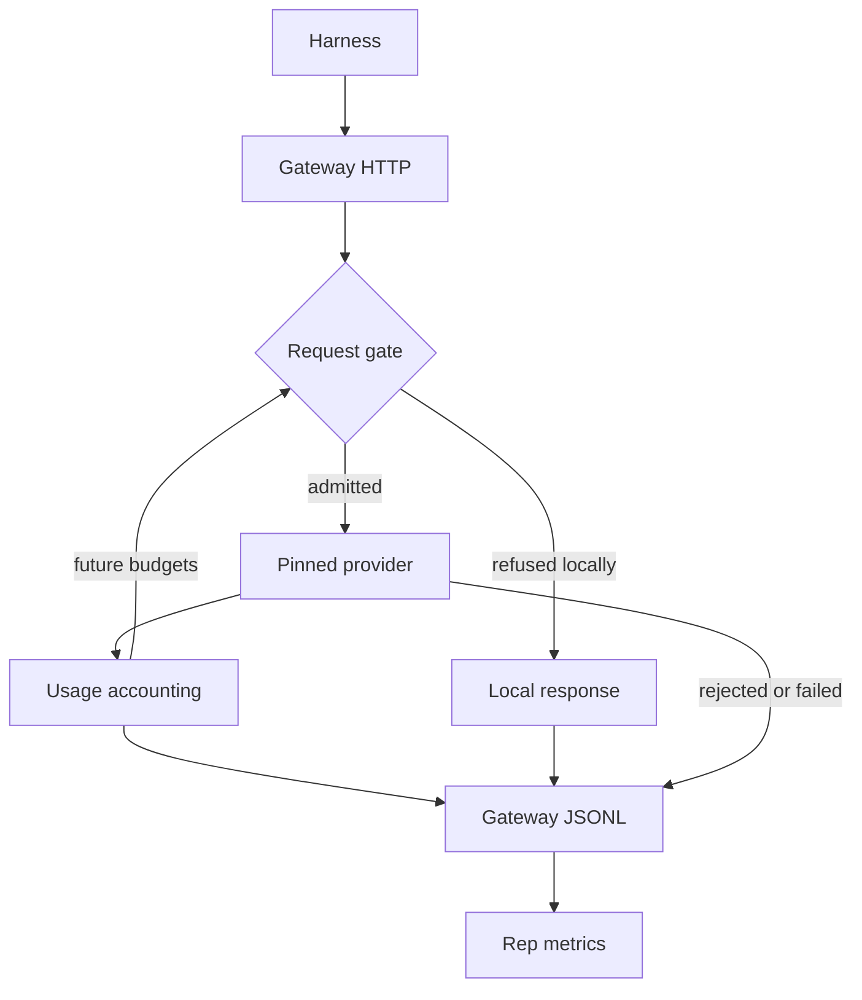

<h3>PR Summary by Qodo</h3>

Add a budgeted, auditable model gateway

<code>✨ Enhancement</code> <code>🧪 Tests</code> <code>📝 Documentation</code> <code>⚙️ Configuration changes</code> <code>🕐 40+ Minutes</code>

AI Description

<dl>
<dd>
 

><pre>
>• Add a pinned-model gateway that isolates provider credentials and enforces call and token budgets.
>• Record usage, retries, failures, and shutdown outcomes so attempts can be accounted for fairly.
>• Update schemas, metrics, timeout planning, documentation, and local-stub functional tests.
></pre>

</dd>
</dl>

Diagram

<dl>
<dd>

 

</dd>
</dl>

High-Level Assessment

<dl>
<dd>

 

>The following are alternative approaches to this PR:

<b>1. Adapt an existing OpenAI proxy</b>

<dl>
<dd>

- ➕ Could reduce custom HTTP and streaming code.
- ➖ Would add a dependency and still require custom admission, accounting, void, and record semantics.

</dd>
</dl>

<b>2. Stream every request upstream</b>

<dl>
<dd>

- ➕ Could reduce unknown usage when a non-streaming provider response times out.
- ➖ Changes upstream request behavior and requires translating streams back into non-streaming responses.

</dd>
</dl>

>**Recommendation:** Keep the dedicated gateway for v1: its fixed upstream, credential boundary, and attempt-accounting rules need close control, and the local-stub tests exercise those rules without model calls. Consider universal upstream streaming separately if unknown usage becomes material.

</dd>
</dl>

 Files changed (9) <code> +2112 / -31 </code> 

<dl>
<dd>

 

Enhancement (3) <code> +1080 / -8 </code>

<dl>
<dd>

gateway.py<code>Implement the pinned-model HTTP gateway</code> <code>+1055/-0</code>

 

>Implement the pinned-model HTTP gateway
>
><pre>
>• Adds a standard-library-only proxy with fixed provider headers, local budget enforcement, streaming usage accounting, bounded retries, and JSONL records. Separates provider or setup failures that void an attempt from harness-controlled errors and requests with unknown usage.
></pre>
>
><a href='https://github.com/SigorMatt/harness-bench/pull/1/files#diff-fef3562d0489296e808673921d86c962355faa436a870c5f670f6d49e9471f96'>hb/gateway.py</a>

metrics.py<code>Derive model activity from forwarded requests</code> <code>+16/-3</code>

 

>Derive model activity from forwarded requests
>
><pre>
>• Excludes locally answered requests from model-call and model-time totals. Adds a count of requests whose usage remains unknown.
></pre>
>
><a href='https://github.com/SigorMatt/harness-bench/pull/1/files#diff-eda7438bec76032570eb615bc93737fcf8b3bfb37d5c6dfc00c2bec061fdaf8e'>hb/metrics.py</a>

gateway-record.schema.json<code>Describe additional gateway record outcomes</code> <code>+9/-5</code>

 

>Describe additional gateway record outcomes
>
><pre>
>• Adds &#x27;usage_unknown&#x27; and &#x27;upstream_failed&#x27; outcomes. Clarifies record scope, retry counts, hashes, response status, and concurrent totals.
></pre>
>
><a href='https://github.com/SigorMatt/harness-bench/pull/1/files#diff-a7f4f5e48d761d3696c5ecbe3cb169b77f274e5db0ce6b40487dd4601af0f08e'>schemas/gateway-record.schema.json</a>

</dd>
</dl>

Tests (2) <code> +905 / -2 </code>

<dl>
<dd>

test_gateway.py<code>Exercise gateway behavior against a local provider</code> <code>+889/-0</code>

 

>Exercise gateway behavior against a local provider
>
><pre>
>• Adds functional coverage for forwarding, TLS, streaming, accounting, budgets, retries, malformed requests, shutdown, logging failures, and CLI behavior. Validates emitted records against the gateway schema without calling a real model.
></pre>
>
><a href='https://github.com/SigorMatt/harness-bench/pull/1/files#diff-4f0390209d7648ae2dbda296ebe43dc6e901a046b178a4e0aff1d78752ee65b7'>tests/test_gateway.py</a>

test_plan_metrics.py<code>Cover revised planning and metric calculations</code> <code>+16/-2</code>

 

>Cover revised planning and metric calculations
>
><pre>
>• Updates the expected job timeout for gateway draining. Verifies that local responses do not count as model activity and unknown-usage requests are reported.
></pre>
>
><a href='https://github.com/SigorMatt/harness-bench/pull/1/files#diff-d496af8d0679ae266c5384b1567cc018fd401a0e7419f62c672710557b99ba53'>tests/test_plan_metrics.py</a>

</dd>
</dl>

Documentation (2) <code> +122 / -20 </code>

<dl>
<dd>

README.md<code>Reflect the gateway in repository status</code> <code>+6/-5</code>

 

>Reflect the gateway in repository status
>
><pre>
>• Identifies the model gateway as implemented while distinguishing it from the toolkit image and other unfinished components.
></pre>
>
><a href='https://github.com/SigorMatt/harness-bench/pull/1/files#diff-b335630551682c19a781afebcf4d07bf978fb1f8ac04c6bf87428ed5106870f5'>README.md</a>

result-bundle.md<code>Specify gateway behavior and attempt outcomes</code> <code>+116/-15</code>

 

>Specify gateway behavior and attempt outcomes
>
><pre>
>• Defines request handling, budgets, safe retries, usage accounting, void conditions, shutdown, and residual risks. Clarifies how gateway outcomes affect reruns, metrics, and leaderboard reporting.
></pre>
>
><a href='https://github.com/SigorMatt/harness-bench/pull/1/files#diff-2165efa4eeda3a5b7c8a6ab23d514b24097e696cb663a4d677b5670d0a25fd48'>docs/spec/result-bundle.md</a>

</dd>
</dl>

Other (2) <code> +5 / -1 </code>

<dl>
<dd>

plan.py<code>Include gateway draining in job timeout planning</code> <code>+2/-1</code>

 

>Include gateway draining in job timeout planning
>
><pre>
>• Adds the gateway&#x27;s 120-second shutdown drain to each attempt&#x27;s worst-case duration.
></pre>
>
><a href='https://github.com/SigorMatt/harness-bench/pull/1/files#diff-19782370be3ee656dae79282a5c795254c797423e8b97d1b69d832fd907b49d5'>hb/plan.py</a>

pyproject.toml<code>Expose the gateway command</code> <code>+3/-0</code>

 

>Expose the gateway command
>
><pre>
>• Registers &#x27;hb-gateway&#x27; as a project script pointing to the gateway entry point.
></pre>
>
><a href='https://github.com/SigorMatt/harness-bench/pull/1/files#diff-50c86b7ed8ac2cf95bd48334961bf0530cdc77b5a56f852c5c61b89d735fd711'>pyproject.toml</a>

</dd>
</dl>

</dd>
</dl>

