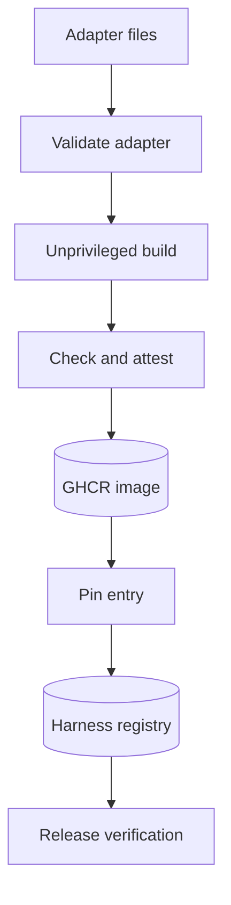

<h3>PR Summary by Qodo</h3>

Build and verify harness images with a baseline agent

<code>✨ Enhancement</code> <code>🧪 Tests</code> <code>📝 Documentation</code> <code>🕐 40+ Minutes</code>

AI Description

<dl>
<dd>
 

><pre>
>• Add a reviewed-adapter pipeline that builds, attests, and pins harness images by digest.
>• Introduce a standard-library baseline agent as the first harness adapter.
>• Separate release builds from publishing and verify registered harness images before release.
></pre>

</dd>
</dl>

Diagram

<dl>
<dd>

 

</dd>
</dl>

High-Level Assessment

<dl>
<dd>

 

>The following are alternative approaches to this PR:

<b>1. Shared image-publishing workflow</b>

<dl>
<dd>

- ➕ Could centralize build-artifact transfer and publication controls across harness and release images.
- ➖ Would need to accommodate different image checks, inputs, and attestation identities, increasing privileged workflow complexity.

</dd>
</dl>

>**Recommendation:** Keep the separate harness and release workflows: their verification contracts differ, and the explicit unprivileged-build-to-privileged-publish boundary is easier to audit. Reuse small verification helpers, as this PR does, rather than generalizing the whole workflow.

</dd>
</dl>

 Files changed (18) <code> +2168 / -87 </code> 

<dl>
<dd>

 

Enhancement (6) <code> +809 / -1 </code>

<dl>
<dd>

Dockerfile<code>Package the baseline adapter</code> <code>+13/-0</code>

 

>Package the baseline adapter
>
><pre>
>• Pins the Python base image and copies the agent and stock configuration under /hb. Leaves command selection to the registry entrypoint.
></pre>
>
><a href='https://github.com/SigorMatt/harness-bench/pull/10/files#diff-a8ffd1481db5f540b49b8d74c937e96dcc354a34058985c55d32233944ab7a10'>harnesses/baseline/Dockerfile</a>

agent.py<code>Implement the reference tool-calling agent</code> <code>+282/-0</code>

 

>Implement the reference tool-calling agent
>
><pre>
>• Adds an OpenAI-compatible conversation loop with five repository tools, bounded command output, timeouts, and gateway error handling. It stops on completion, budget refusal, or its step limit.
></pre>
>
><a href='https://github.com/SigorMatt/harness-bench/pull/10/files#diff-67cc2980a713db4d733311b676c83d5f320524e613506897bc0ce1e21e2b854e'>harnesses/baseline/agent.py</a>

harness.py<code>Add adapter, image, and registry verification</code> <code>+282/-0</code>

 

>Add adapter, image, and registry verification
>
><pre>
>• Validates adapter metadata, derives registry entries and configuration digests from committed files, and checks image labels, entrypoints, files, and provenance command arguments. Provides helpers for pinning and verifying digest-referenced images.
></pre>
>
><a href='https://github.com/SigorMatt/harness-bench/pull/10/files#diff-b3df44f2e037b8a49f3ed9b57888111ddb740046ade6f8baa7dc18efe6115198'>hb/harness.py</a>

harness.schema.json<code>Define the harness adapter schema</code> <code>+41/-0</code>

 

>Define the harness adapter schema
>
><pre>
>• Adds the hb/harness/1 schema for adapter identity, version, homepage, and entrypoint arguments.
></pre>
>
><a href='https://github.com/SigorMatt/harness-bench/pull/10/files#diff-a4972db08f2c9a742fea9b7ca7478bf906dfe36147f5bcd56b10116eb23443f2'>schemas/harness.schema.json</a>

registry.schema.json<code>Record optional harness build commits</code> <code>+5/-1</code>

 

>Record optional harness build commits
>
><pre>
>• Adds an optional build_commit field and clarifies that config_digest identifies the adapter&#x27;s stock configuration tree.
></pre>
>
><a href='https://github.com/SigorMatt/harness-bench/pull/10/files#diff-28af4f230125334ee8662818f4fb0ee8ead62a21eea20f9690792053731be40c'>schemas/registry.schema.json</a>

harness.py<code>Expose harness build and registration commands</code> <code>+186/-0</code>

 

>Expose harness build and registration commands
>
><pre>
>• Adds workflow commands for validation, image checks, naming, and pin artifacts, plus maintainer commands to pin and verify registry entries. Verification supports offline entry checks or online image and attestation checks.
></pre>
>
><a href='https://github.com/SigorMatt/harness-bench/pull/10/files#diff-29101e19d8c7f2fd67794038f1f632b7801ea839cd316471aa04e5bb32b565dd'>scripts/harness.py</a>

</dd>
</dl>

Refactor (2) <code> +54 / -30 </code>

<dl>
<dd>

release.py<code>Share anonymous Docker verification</code> <code>+52/-0</code>

 

>Share anonymous Docker verification
>
><pre>
>• Moves empty-Docker-config command execution into a reusable helper so release and harness verification can check public image pulls.
></pre>
>
><a href='https://github.com/SigorMatt/harness-bench/pull/10/files#diff-dffdbb27cb5ed15cd9c455959d38dd9cb968826603c23d04c7089df62dd56a05'>hb/release.py</a>

release.py<code>Use shared anonymous verification</code> <code>+2/-30</code>

 

>Use shared anonymous verification
>
><pre>
>• Replaces its local Docker-context and anonymous command handling with the reusable release-library helper.
></pre>
>
><a href='https://github.com/SigorMatt/harness-bench/pull/10/files#diff-89ed454114d0872b1f47e4be4810fc351f5b8a09b82c9ee1b1b064f175bfa4b8'>scripts/release.py</a>

</dd>
</dl>

Tests (4) <code> +834 / -5 </code>

<dl>
<dd>

test_baseline_agent.py<code>Test baseline agent conversations and tools</code> <code>+313/-0</code>

 

>Test baseline agent conversations and tools
>
><pre>
>• Exercises the agent against a scripted gateway, covering tool calls, malformed responses, output limits, timeouts, budget refusal, and stopping conditions.
></pre>
>
><a href='https://github.com/SigorMatt/harness-bench/pull/10/files#diff-b4761ef56f7ecbaa740910970a5eff93d5422f564c06c801a3a16977ce5f4738'>tests/test_baseline_agent.py</a>

test_harness.py<code>Test harness pinning and image verification</code> <code>+469/-0</code>

 

>Test harness pinning and image verification
>
><pre>
>• Covers adapter validation, committed-file entry derivation, image checks, registry pinning, and offline and simulated online verification. Includes negative cases for altered configuration, symlinks, labels, and provenance failures.
></pre>
>
><a href='https://github.com/SigorMatt/harness-bench/pull/10/files#diff-9cc4599bd398d38b406f115c5a5dd03630947733a395812991de64b28064ff9b'>tests/test_harness.py</a>

test_run_task_docker.py<code>Exercise baseline in a Docker-backed rep</code> <code>+51/-5</code>

 

>Exercise baseline in a Docker-backed rep
>
><pre>
>• Adds an opt-in integration test that builds the baseline image, sends tool calls through the gateway, and confirms it fixes and grades the task.
></pre>
>
><a href='https://github.com/SigorMatt/harness-bench/pull/10/files#diff-091eac90697dc045a5dbec15548988e1769eec2765296b8aa8f8becc0e597b72'>tests/test_run_task_docker.py</a>

test_schemas.py<code>Validate baseline adapter against its schema</code> <code>+1/-0</code>

 

>Validate baseline adapter against its schema
>
><pre>
>• Includes baseline harness metadata in the schema validation fixtures.
></pre>
>
><a href='https://github.com/SigorMatt/harness-bench/pull/10/files#diff-29a33be0fdb1f4328b7296113433da576897df90fbe45f93ab784deeef86ec2d'>tests/test_schemas.py</a>

</dd>
</dl>

Documentation (2) <code> +133 / -27 </code>

<dl>
<dd>

README.md<code>Document harness adapters and registration</code> <code>+29/-12</code>

 

>Document harness adapters and registration
>
><pre>
>• Updates project status and layout to include the harness pipeline and baseline adapter. Adds contributor guidance for building, publishing, and registering a harness.
></pre>
>
><a href='https://github.com/SigorMatt/harness-bench/pull/10/files#diff-b335630551682c19a781afebcf4d07bf978fb1f8ac04c6bf87428ed5106870f5'>README.md</a>

result-bundle.md<code>Specify harness image provenance and release checks</code> <code>+104/-15</code>

 

>Specify harness image provenance and release checks
>
><pre>
>• Defines adapter contents, image checks, registry pinning, provenance verification, and the baseline harness. Updates the release procedure to describe separated build and publishing jobs.
></pre>
>
><a href='https://github.com/SigorMatt/harness-bench/pull/10/files#diff-2165efa4eeda3a5b7c8a6ab23d514b24097e696cb663a4d677b5670d0a25fd48'>docs/spec/result-bundle.md</a>

</dd>
</dl>

Other (4) <code> +338 / -24 </code>

<dl>
<dd>

harness.yml<code>Add the harness image publishing workflow</code> <code>+215/-0</code>

 

>Add the harness image publishing workflow
>
><pre>
>• Adds main-only validation, unprivileged build, and privileged image-checking and publishing jobs. The workflow attests the pushed image and uploads digest pins for a subsequent registry PR.
></pre>
>
><a href='https://github.com/SigorMatt/harness-bench/pull/10/files#diff-adc915ebe1735a443eadafb5006947007007e32ef2e4abb66f2dd9da784decf8'>.github/workflows/harness.yml</a>

release.yml<code>Separate release builds from publication</code> <code>+102/-24</code>

 

>Separate release builds from publication
>
><pre>
>• Moves toolkit and suite builds into a job without write permissions and transfers their images to the publishing job. That job verifies registry harnesses, checks transferred image IDs, and runs toolkit checks in a restricted container.
></pre>
>
><a href='https://github.com/SigorMatt/harness-bench/pull/10/files#diff-87db21a973eed4fef5f32b267aa60fcee5cbdf03c67fafdc2a9b553bb0b15f34'>.github/workflows/release.yml</a>

agent.json<code>Define baseline stock settings</code> <code>+11/-0</code>

 

>Define baseline stock settings
>
><pre>
>• Sets the agent prompt, sampling parameters, step limit, and request, command, and output bounds.
></pre>
>
><a href='https://github.com/SigorMatt/harness-bench/pull/10/files#diff-d10d49d57e7ea29fa18616f7533eea86f33c212091fd4284a3621509d059fb40'>harnesses/baseline/config/agent.json</a>

harness.json<code>Declare baseline harness metadata</code> <code>+10/-0</code>

 

>Declare baseline harness metadata
>
><pre>
>• Declares the adapter schema, baseline identity and version, homepage, and registry-controlled entrypoint.
></pre>
>
><a href='https://github.com/SigorMatt/harness-bench/pull/10/files#diff-aef7aafd978b688b443e2ff5295b556f3ef56979fe700d4c78c51c583d571eb1'>harnesses/baseline/harness.json</a>

</dd>
</dl>

</dd>
</dl>

