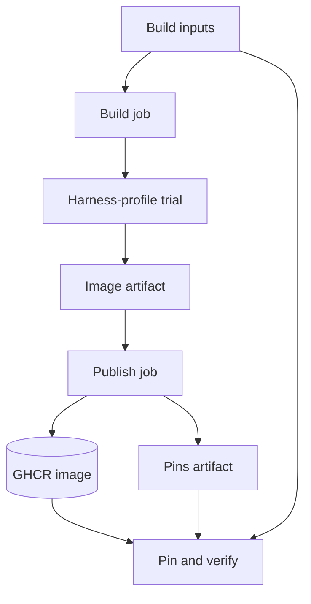

<h3>PR Summary by Qodo</h3>

Add a shared task-base image and verified pinning workflow

<code>✨ Enhancement</code> <code>🧪 Tests</code> <code>📝 Documentation</code> <code>⚙️ Configuration changes</code> <code>🕐 40+ Minutes</code>

AI Description

<dl>
<dd>
 

><pre>
>• Define a shared Python, git, and pytest image to give future harnesses consistent tools.
>• Build, trial, publish, and attest the image through separate least-privilege workflow jobs.
>• Add pinning and verification tools that reject stale build files and unverified image provenance.
></pre>

</dd>
</dl>

Diagram

<dl>
<dd>

 

</dd>
</dl>

High-Level Assessment

<dl>
<dd>

 

>The separate build and publishing jobs are appropriate because dependencies execute only in the job without write or attestation permissions. Digest pinning with build-file and provenance checks fits the existing image-release approach; combining the jobs would weaken that boundary. This PR prepares the base and its pinning process but does not yet pin an image or make harnesses use it.

</dd>
</dl>

 Files changed (12) <code> +1016 / -8 </code> 

<dl>
<dd>

 

Enhancement (3) <code> +264 / -0 </code>

<dl>
<dd>

task-base.Dockerfile<code>Define the shared agent-environment image</code> <code>+29/-0</code>

 

>Define the shared agent-environment image
>
><pre>
>• Starts from the toolkit&#x27;s pinned Python base and installs git, patch, and hash-pinned pytest. Configures a system git identity and an account for the harness UID.
></pre>
>
><a href='https://github.com/SigorMatt/harness-bench/pull/11/files#diff-c8ea5368fa7f40c76908a22e49c369c37614c7833391e7e79603b209621ff6fe'>docker/task-base.Dockerfile</a>

taskbase.py<code>Validate task-base pins and build provenance inputs</code> <code>+129/-0</code>

 

>Validate task-base pins and build provenance inputs
>
><pre>
>• Adds standard-library checks for pin documents, image references, and committed build-file objects and modes. Defines the anonymous pull and GitHub attestation commands used to verify a pinned image.
></pre>
>
><a href='https://github.com/SigorMatt/harness-bench/pull/11/files#diff-16be71137842e541134567ecac2741afdf88d4a3bfbcb0fd7f260fe23a4208a1'>hb/taskbase.py</a>

task_base.py<code>Add task-base naming, pinning, and verification commands</code> <code>+106/-0</code>

 

>Add task-base naming, pinning, and verification commands
>
><pre>
>• Provides workflow commands for image names and pin artifacts, plus maintainer commands to write and verify task-base.json. Pinning rejects a dirty tree or changed build files; online verification checks anonymous access and attestation.
></pre>
>
><a href='https://github.com/SigorMatt/harness-bench/pull/11/files#diff-1883ef0e43d50759e9ac139412ecb4eeb507d11215278b700b8e0b71ccabe172'>scripts/task_base.py</a>

</dd>
</dl>

Documentation (3) <code> +94 / -7 </code>

<dl>
<dd>

README.md<code>Document the task-base lifecycle</code> <code>+19/-7</code>

 

>Document the task-base lifecycle
>
><pre>
>• Adds the task base to the repository overview and explains the maintainer workflow for building and pinning it. Clarifies that the first pin has not yet been added.
></pre>
>
><a href='https://github.com/SigorMatt/harness-bench/pull/11/files#diff-b335630551682c19a781afebcf4d07bf978fb1f8ac04c6bf87428ed5106870f5'>README.md</a>

toolkit-base.Dockerfile<code>Explain the shared Python base pin</code> <code>+3/-0</code>

 

>Explain the shared Python base pin
>
><pre>
>• Documents why the toolkit and task-base Dockerfiles must pin the same Python image and notes the test enforcing it.
></pre>
>
><a href='https://github.com/SigorMatt/harness-bench/pull/11/files#diff-964e331b9c82bee6236e1b794415ff458bd2f4018dc89909ea4b99586ad2b6ed'>docker/toolkit-base.Dockerfile</a>

result-bundle.md<code>Specify task-base construction and provenance</code> <code>+72/-0</code>

 

>Specify task-base construction and provenance
>
><pre>
>• Adds section 6.5 covering image contents, job permissions, publishing, pin verification, and planned harness integration. Adds the task-base module to the reference-library index.
></pre>
>
><a href='https://github.com/SigorMatt/harness-bench/pull/11/files#diff-2165efa4eeda3a5b7c8a6ab23d514b24097e696cb663a4d677b5670d0a25fd48'>docs/spec/result-bundle.md</a>

</dd>
</dl>

Other (6) <code> +658 / -1 </code>

<dl>
<dd>

task-base.yml<code>Build, trial, publish, and attest the task base</code> <code>+190/-0</code>

 

>Build, trial, publish, and attest the task base
>
><pre>
>• Adds a main-only manual workflow with an unprivileged build-and-trial job and a separate publishing job. The latter checks the transferred image, pushes and attests it, and uploads pins for a maintainer.
></pre>
>
><a href='https://github.com/SigorMatt/harness-bench/pull/11/files#diff-77fc52776ec5e36b696ffe994d8829478e66a6f087d5e246d215985b0f44beb7'>.github/workflows/task-base.yml</a>

task-base-requirements.txt<code>Pin pytest and its dependencies by wheel hash</code> <code>+9/-0</code>

 

>Pin pytest and its dependencies by wheel hash
>
><pre>
>• Records exact versions and SHA-256 hashes for pytest and four dependencies for hash-checked installation.
></pre>
>
><a href='https://github.com/SigorMatt/harness-bench/pull/11/files#diff-be173a2362bfaf9275ce46ec2c3cd8e2129f45e648d4c6e95049b7bdc9a5ec79'>docker/task-base-requirements.txt</a>

release.py<code>Name the task-base image repository</code> <code>+1/-0</code>

 

>Name the task-base image repository
>
><pre>
>• Adds the GHCR repository constant used by task-base pin validation and workflow naming.
></pre>
>
><a href='https://github.com/SigorMatt/harness-bench/pull/11/files#diff-dffdbb27cb5ed15cd9c455959d38dd9cb968826603c23d04c7089df62dd56a05'>hb/release.py</a>

task-base.schema.json<code>Define the task-base pin schema</code> <code>+23/-0</code>

 

>Define the task-base pin schema
>
><pre>
>• Defines the required schema version, digest-pinned GHCR image, and full build commit for task-base.json.
></pre>
>
><a href='https://github.com/SigorMatt/harness-bench/pull/11/files#diff-59ed163f97e3e98e9cbaf380020f290f0a69374e14a96f4797e9dfe0a7072a98'>schemas/task-base.schema.json</a>

test_run_task_docker.py<code>Exercise the built image under workflow trial settings</code> <code>+29/-1</code>

 

>Exercise the built image under workflow trial settings
>
><pre>
>• Adds an opt-in Docker test that builds the task base and runs the workflow&#x27;s trial commands, checking pytest, user lookup, and git output. Improves captured diagnostics for Docker build failures.
></pre>
>
><a href='https://github.com/SigorMatt/harness-bench/pull/11/files#diff-091eac90697dc045a5dbec15548988e1769eec2765296b8aa8f8becc0e597b72'>tests/test_run_task_docker.py</a>

test_task_base.py<code>Test image constraints and pin-verification behavior</code> <code>+406/-0</code>

 

>Test image constraints and pin-verification behavior
>
><pre>
>• Covers base-image equality, hashed requirements, Dockerfile and workflow profile constraints, schema validation, CLI behavior, and committed build-file comparisons. Uses stand-ins to check anonymous pull and attestation command execution without network access.
></pre>
>
><a href='https://github.com/SigorMatt/harness-bench/pull/11/files#diff-94b4ed4943641850e3307c311d6cabc19362c7721a1e3c50ea5ebffb81caf904'>tests/test_task_base.py</a>

</dd>
</dl>

</dd>
</dl>

