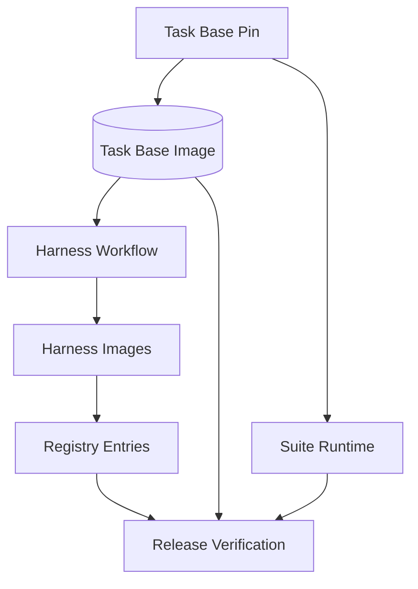

<h3>PR Summary by Qodo</h3>

Build harness images on the pinned task base and verify their layers

<code>✨ Enhancement</code> <code>⚙️ Configuration changes</code> <code>🧪 Tests</code> <code>📝 Documentation</code> <code>🕐 40+ Minutes</code>

AI Description

<dl>
<dd>
 

><pre>
>• Build harness images on the pinned task base and verify their inherited layers before publication.
>• Bind suite cohorts and registry entries to that pin; reject mismatches during registration and
>  release.
>• Commit the first task-base pin and expand tests, examples, and documentation.
></pre>

</dd>
</dl>

Diagram

<dl>
<dd>

 

</dd>
</dl>

High-Level Assessment

<dl>
<dd>

 

>Keep the committed digest pin, build-commit-derived registry field, and inspection of published image layers. Checking Dockerfile text or registry metadata alone would not establish that the resulting image starts with the pinned base; the documented limit is that later harness layers can still shadow its tools.

</dd>
</dl>

 Files changed (25) <code> +706 / -187 </code> 

<dl>
<dd>

 

Enhancement (9) <code> +242 / -72 </code>

<dl>
<dd>

harness.yml<code>Build and inspect harness images against the pinned base</code> <code>+19/-9</code>

 

>Build and inspect harness images against the pinned base
>
><pre>
>• Passes TASK_BASE to adapter builds. The image job pulls the base anonymously by digest and compares its inspected layers with the built image before publication.
></pre>
>
><a href='https://github.com/SigorMatt/harness-bench/pull/12/files#diff-adc915ebe1735a443eadafb5006947007007e32ef2e4abb66f2dd9da784decf8'>.github/workflows/harness.yml</a>

release.yml<code>Verify the task base before registry images</code> <code>+15/-5</code>

 

>Verify the task base before registry images
>
><pre>
>• Adds task-base verification to the release images job ahead of harness registry verification.
></pre>
>
><a href='https://github.com/SigorMatt/harness-bench/pull/12/files#diff-87db21a973eed4fef5f32b267aa60fcee5cbdf03c67fafdc2a9b553bb0b15f34'>.github/workflows/release.yml</a>

Dockerfile<code>Build the baseline adapter from TASK_BASE</code> <code>+9/-5</code>

 

>Build the baseline adapter from TASK_BASE
>
><pre>
>• Replaces its standalone Python base with the required TASK_BASE build argument and final-stage base.
></pre>
>
><a href='https://github.com/SigorMatt/harness-bench/pull/12/files#diff-a8ffd1481db5f540b49b8d74c937e96dcc354a34058985c55d32233944ab7a10'>harnesses/baseline/Dockerfile</a>

harness.py<code>Bind registry entries and image checks to the task base</code> <code>+57/-19</code>

 

>Bind registry entries and image checks to the task base
>
><pre>
>• Derives each entry&#x27;s task_base from its build commit, checks it against the current pin and unchanged base build files, and compares pulled harness layers with the base.
></pre>
>
><a href='https://github.com/SigorMatt/harness-bench/pull/12/files#diff-b3df44f2e037b8a49f3ed9b57888111ddb740046ade6f8baa7dc18efe6115198'>hb/harness.py</a>

release.py<code>Reject release inputs with inconsistent task-base pins</code> <code>+16/-6</code>

 

>Reject release inputs with inconsistent task-base pins
>
><pre>
>• Requires a valid task-base document and checks that the release suite and every registry entry name its image.
></pre>
>
><a href='https://github.com/SigorMatt/harness-bench/pull/12/files#diff-dffdbb27cb5ed15cd9c455959d38dd9cb968826603c23d04c7089df62dd56a05'>hb/release.py</a>

taskbase.py<code>Add suite-pin and image-layer validation helpers</code> <code>+62/-1</code>

 

>Add suite-pin and image-layer validation helpers
>
><pre>
>• Adds helpers to check and set runtime.task_base, validate image layer digests, identify an inspected base reference, and compare a harness image&#x27;s layer prefix.
></pre>
>
><a href='https://github.com/SigorMatt/harness-bench/pull/12/files#diff-16be71137842e541134567ecac2741afdf88d4a3bfbcb0fd7f260fe23a4208a1'>hb/taskbase.py</a>

harness.py<code>Enforce the base pin throughout harness commands</code> <code>+36/-15</code>

 

>Enforce the base pin throughout harness commands
>
><pre>
>• Outputs the pinned base for builds, requires its inspection during check-image, and rejects stale or mismatched pins during registration and verification. Online verification pulls the base anonymously and checks harness layers.
></pre>
>
><a href='https://github.com/SigorMatt/harness-bench/pull/12/files#diff-29101e19d8c7f2fd67794038f1f632b7801ea839cd316471aa04e5bb32b565dd'>scripts/harness.py</a>

release.py<code>Pass the task-base pin to release input validation</code> <code>+6/-3</code>

 

>Pass the task-base pin to release input validation
>
><pre>
>• Makes the release inputs command validate the root task-base.json alongside the suite and registry.
></pre>
>
><a href='https://github.com/SigorMatt/harness-bench/pull/12/files#diff-89ed454114d0872b1f47e4be4810fc351f5b8a09b82c9ee1b1b064f175bfa4b8'>scripts/release.py</a>

task_base.py<code>Synchronize the suite when pinning the task base</code> <code>+22/-9</code>

 

>Synchronize the suite when pinning the task base
>
><pre>
>• Updates runtime.task_base when an actual suite exists and verifies that it matches the pin. Pinning still works before the suite is added.
></pre>
>
><a href='https://github.com/SigorMatt/harness-bench/pull/12/files#diff-1883ef0e43d50759e9ac139412ecb4eeb507d11215278b700b8e0b71ccabe172'>scripts/task_base.py</a>

</dd>
</dl>

Tests (5) <code> +315 / -43 </code>

<dl>
<dd>

test_harness.py<code>Cover harness pin and layer enforcement</code> <code>+149/-18</code>

 

>Cover harness pin and layer enforcement
>
><pre>
>• Exercises build outputs, base inspection failures, anonymous verification, stale build files, mismatched pins, and build commits without a base pin.
></pre>
>
><a href='https://github.com/SigorMatt/harness-bench/pull/12/files#diff-9cc4599bd398d38b406f115c5a5dd03630947733a395812991de64b28064ff9b'>tests/test_harness.py</a>

test_release.py<code>Cover release input task-base consistency</code> <code>+25/-8</code>

 

>Cover release input task-base consistency
>
><pre>
>• Adds the example base pin to release fixtures and tests missing, malformed, or mismatched suite and registry references.
></pre>
>
><a href='https://github.com/SigorMatt/harness-bench/pull/12/files#diff-5614bdd8567cb2d34c39f4c8592ae23121af38ce2ef744ddb0640352f825e926'>tests/test_release.py</a>

test_run_task_docker.py<code>Test baseline inheritance with real Docker images</code> <code>+43/-17</code>

 

>Test baseline inheritance with real Docker images
>
><pre>
>• Builds the baseline on the task base and checks real image layers against both matching and unrelated images. These Docker tests remain opt-in.
></pre>
>
><a href='https://github.com/SigorMatt/harness-bench/pull/12/files#diff-091eac90697dc045a5dbec15548988e1769eec2765296b8aa8f8becc0e597b72'>tests/test_run_task_docker.py</a>

test_schemas.py<code>Validate new example pins and required runtime fields</code> <code>+6/-0</code>

 

>Validate new example pins and required runtime fields
>
><pre>
>• Adds the example task-base document to schema checks and rejects suites or cohorts without valid runtime.task_base references.
></pre>
>
><a href='https://github.com/SigorMatt/harness-bench/pull/12/files#diff-29a33be0fdb1f4328b7296113433da576897df90fbe45f93ab784deeef86ec2d'>tests/test_schemas.py</a>

test_task_base.py<code>Cover layer-prefix checks and suite pin synchronization</code> <code>+92/-0</code>

 

>Cover layer-prefix checks and suite pin synchronization
>
><pre>
>• Tests valid and malformed image inspections, incorrect layer ordering, suite pin replacement, and verification of mismatched suites.
></pre>
>
><a href='https://github.com/SigorMatt/harness-bench/pull/12/files#diff-94b4ed4943641850e3307c311d6cabc19362c7721a1e3c50ea5ebffb81caf904'>tests/test_task_base.py</a>

</dd>
</dl>

Documentation (2) <code> +117 / -63 </code>

<dl>
<dd>

README.md<code>Document task-base requirements for adapters and suites</code> <code>+9/-6</code>

 

>Document task-base requirements for adapters and suites
>
><pre>
>• Explains the TASK_BASE Dockerfile contract, matching suite pin, and need to rebuild and register harness images after a base change.
></pre>
>
><a href='https://github.com/SigorMatt/harness-bench/pull/12/files#diff-b335630551682c19a781afebcf4d07bf978fb1f8ac04c6bf87428ed5106870f5'>README.md</a>

result-bundle.md<code>Specify task-base enforcement and its limits</code> <code>+108/-57</code>

 

>Specify task-base enforcement and its limits
>
><pre>
>• Documents the suite and registry pins, build and release checks, and resulting cohort identity. Adds a residual risk for tools shadowed by harness-owned layers or environment settings.
></pre>
>
><a href='https://github.com/SigorMatt/harness-bench/pull/12/files#diff-2165efa4eeda3a5b7c8a6ab23d514b24097e696cb663a4d677b5670d0a25fd48'>docs/spec/result-bundle.md</a>

</dd>
</dl>

Other (9) <code> +32 / -9 </code>

<dl>
<dd>

cohort.json<code>Include the base pin in the example cohort</code> <code>+3/-2</code>

 

>Include the base pin in the example cohort
>
><pre>
>• Adds runtime.task_base and refreshes the suite digest used by the generated cohort.
></pre>
>
><a href='https://github.com/SigorMatt/harness-bench/pull/12/files#diff-29b938eefafec67eb226c9e1e458508baf66f1c24616bd65e1ef22fb8169ad30'>examples/cohort.json</a>

registry.json<code>Record task-base references in example registry entries</code> <code>+4/-2</code>

 

>Record task-base references in example registry entries
>
><pre>
>• Adds a matching task_base image reference to each example harness entry.
></pre>
>
><a href='https://github.com/SigorMatt/harness-bench/pull/12/files#diff-c74956045dae62faaba438f8ea8ee5a8e8ac741b60cfd8748c0eba2b58fa6201'>examples/registry.json</a>

release.json<code>Refresh the example release cohort ID</code> <code>+1/-1</code>

 

>Refresh the example release cohort ID
>
><pre>
>• Updates the generated cohort ID to reflect the changed suite runtime and digest.
></pre>
>
><a href='https://github.com/SigorMatt/harness-bench/pull/12/files#diff-8864cdd39abd60e7dd119215bcf2d1942e917a4db35ede78b9169a2064592910'>examples/release.json</a>

run-manifest.json<code>Refresh the example run&#x27;s cohort data</code> <code>+3/-2</code>

 

>Refresh the example run&#x27;s cohort data
>
><pre>
>• Carries the revised suite digest and runtime.task_base into the generated run manifest.
></pre>
>
><a href='https://github.com/SigorMatt/harness-bench/pull/12/files#diff-20dca5255445bee61c298027f7854751184d0f8be05dc74baec983673b3f5767'>examples/run/run-manifest.json</a>

suite.json<code>Pin a task base in the example suite</code> <code>+2/-1</code>

 

>Pin a task base in the example suite
>
><pre>
>• Adds runtime.task_base so the example suite supplies the new required cohort field.
></pre>
>
><a href='https://github.com/SigorMatt/harness-bench/pull/12/files#diff-88f19e4b889bf4d6c12ad9ae05191832ef95fc000b76a6ddb19a1c6a1731366b'>examples/suite/suite.json</a>

task-base.json<code>Add an example task-base pin</code> <code>+5/-0</code>

 

>Add an example task-base pin
>
><pre>
>• Provides a task-base document matching the image reference used by the example suite and registry.
></pre>
>
><a href='https://github.com/SigorMatt/harness-bench/pull/12/files#diff-b99966dc0d10d400fc1396a39c5dae62bb35c9ed50b2e88da1ea3f8c09fcfa91'>examples/task-base.json</a>

common.schema.json<code>Require task_base in runtime objects</code> <code>+5/-1</code>

 

>Require task_base in runtime objects
>
><pre>
>• Adds a required digest-pinned task_base image reference to the shared runtime definition used by suites, cohorts, and run manifests.
></pre>
>
><a href='https://github.com/SigorMatt/harness-bench/pull/12/files#diff-31edf65be22d4f42ac287db7def2ad0cb9d0ba3048ca54c6ba41439b882a7cc8'>schemas/common.schema.json</a>

registry.schema.json<code>Define registry task_base references</code> <code>+4/-0</code>

 

>Define registry task_base references
>
><pre>
>• Adds a task_base image-reference property for harness entries, separate from their entry key.
></pre>
>
><a href='https://github.com/SigorMatt/harness-bench/pull/12/files#diff-28af4f230125334ee8662818f4fb0ee8ead62a21eea20f9690792053731be40c'>schemas/registry.schema.json</a>

task-base.json<code>Commit the first task-base image pin</code> <code>+5/-0</code>

 

>Commit the first task-base image pin
>
><pre>
>• Records the digest-pinned GHCR task-base image and the commit from which it was built.
></pre>
>
><a href='https://github.com/SigorMatt/harness-bench/pull/12/files#diff-780110b63b0194f97731f89d12aa4ca39e3a0bd616115c114ac4bd6754de6c16'>task-base.json</a>

</dd>
</dl>

</dd>
</dl>

