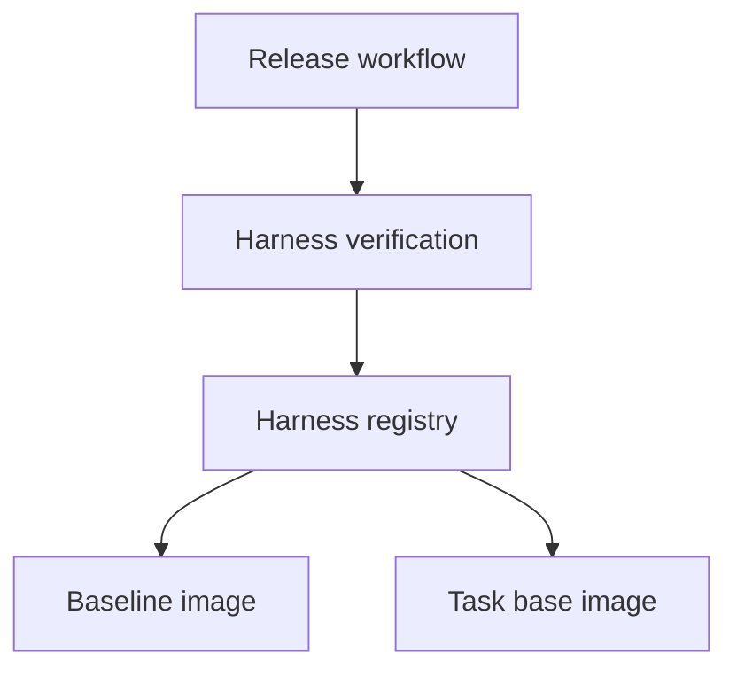

<h3>PR Summary by Qodo</h3>

Register baseline harness version 0.1.0

<code>⚙️ Configuration changes</code> <code>🕐 10-20 Minutes</code>

AI Description

<dl>
<dd>
 

><pre>
>• Add the baseline 0.1.0 harness to the registry for release verification and use.
>• Pin its image, build commit, configuration digest, and task base for reproducibility.
></pre>

</dd>
</dl>

Diagram

<dl>
<dd>

 

</dd>
</dl>

High-Level Assessment

<dl>
<dd>

 

>Keep the generated registry entry. It uses the existing pin-and-verify workflow and immutable image digests; a mutable image tag would weaken reproducibility.

</dd>
</dl>

 Files changed (1) <code> +18 / -0 </code> 

<dl>
<dd>

 

Other (1) <code> +18 / -0 </code>

<dl>
<dd>

registry.json<code>Register the baseline 0.1.0 harness</code> <code>+18/-0</code>

 

>Register the baseline 0.1.0 harness
>
><pre>
>• Creates the harness registry with a baseline entry. The entry records the image digest, configuration digest, entrypoint, homepage, build commit, and pinned task base.
></pre>
>
><a href='https://github.com/SigorMatt/harness-bench/pull/13/files#diff-c1ccab6b761f7c3ef53302c329215f605bb24c73aa16fb75bc4da712926e972b'>registry.json</a>

</dd>
</dl>

</dd>
</dl>

