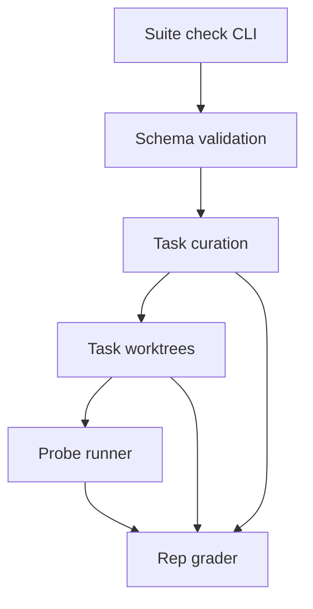

<h3>PR Summary by Qodo</h3>

Add py-maint pilot suite and task curation checks

<code>✨ Enhancement</code> <code>🧪 Tests</code> <code>📝 Documentation</code> <code>⚙️ Configuration changes</code> <code>🕐 40+ Minutes</code>

AI Description

<dl>
<dd>
 

><pre>
>• Add seven Python maintenance tasks, one per category, to exercise the release and grading
>  workflow.
>• Check task scope, probe stability, pristine behavior, and reference solutions before a suite
>  grades harnesses.
>• Document curation and test the pilot repositories, probes, CLI, and Docker sandbox.
></pre>

</dd>
</dl>

Diagram

<dl>
<dd>

 

</dd>
</dl>

High-Level Assessment

<dl>
<dd>

 

>Keep curation separate from release-input validation while reusing the existing probe and rep-grading contracts. This checks that the published grading path resolves each task without maintaining a second verdict implementation; a bespoke curation grader would duplicate critical logic.

</dd>
</dl>

 Files changed (149) <code> +4714 / -7 </code> 

<dl>
<dd>

 

Enhancement (58) <code> +1819 / -0 </code>

<dl>
<dd>

curate.py<code>Curate tasks against behavioral and grading rules</code> <code>+149/-0</code>

 

>Curate tasks against behavioral and grading rules
>
><pre>
>• Checks metadata, case separation, deterministic observations, pristine behavior, solution scope, and whether the existing grader resolves the reference solution. Runs probes on isolated copies.
></pre>
>
><a href='https://github.com/SigorMatt/harness-bench/pull/14/files#diff-2711d23a867c76bd042a1431f643cededbf0dc01abf0ed75e1a03be393104fc1'>hb/curate.py</a>

suite.py<code>Add suite check command with optional sandbox probes</code> <code>+86/-0</code>

 

>Add suite check command with optional sandbox probes
>
><pre>
>• Validates suite and task inputs before curation; supports local Python probes or Docker toolkit probes and reports per-task results.
></pre>
>
><a href='https://github.com/SigorMatt/harness-bench/pull/14/files#diff-c6e66c2a4153fecf5b0dce75cfe31c3a4fad297f80c0554baec09ea82c9dd922'>scripts/suite.py</a>

__init__.py<code>Expose the envfile package API</code> <code>+8/-0</code>

 

>Expose the envfile package API
>
><pre>
>• Makes parser, writer, and error interfaces available to consumers.
></pre>
>
><a href='https://github.com/SigorMatt/harness-bench/pull/14/files#diff-28120b627496f0b910b931ac60f10d1635ba3204ee667305d9329d857f87bdab'>suites/py-maint/tasks/envfile-values/repo/envfile/__init__.py</a>

errors.py<code>Define envfile parsing errors</code> <code>+9/-0</code>

 

>Define envfile parsing errors
>
><pre>
>• Introduces the package error carrying line information for malformed input.
></pre>
>
><a href='https://github.com/SigorMatt/harness-bench/pull/14/files#diff-f4a657a4956e690fe551145312d3f913c6fb673ee5dbcebe7c5caefc8fb45983'>suites/py-maint/tasks/envfile-values/repo/envfile/errors.py</a>

parser.py<code>Seed the faulty envfile parser</code> <code>+78/-0</code>

 

>Seed the faulty envfile parser
>
><pre>
>• Provides the task repository&#x27;s parser, including the equals-sign value truncation that agents must repair.
></pre>
>
><a href='https://github.com/SigorMatt/harness-bench/pull/14/files#diff-6e8964be783dea27369e828e0b7c8400e66fabb72767f48c57d5868688a1cf0f'>suites/py-maint/tasks/envfile-values/repo/envfile/parser.py</a>

writer.py<code>Add envfile serialization behavior</code> <code>+34/-0</code>

 

>Add envfile serialization behavior
>
><pre>
>• Provides the writer used by the repository tests and preservation probes.
></pre>
>
><a href='https://github.com/SigorMatt/harness-bench/pull/14/files#diff-c3697cc7befacc062687e04beed1c1be0283e4be8d632628a37234c8dec1ff48'>suites/py-maint/tasks/envfile-values/repo/envfile/writer.py</a>

__init__.py<code>Expose ledgerkit&#x27;s public interfaces</code> <code>+11/-0</code>

 

>Expose ledgerkit&#x27;s public interfaces
>
><pre>
>• Provides package-level access to the journal, money, parsing, and conversion operations.
></pre>
>
><a href='https://github.com/SigorMatt/harness-bench/pull/14/files#diff-b63b38320dbc89de9a8cc5ba5fc42d7ed4353714ae24eb53e42dea3da3455808'>suites/py-maint/tasks/ledger-fx-report/repo/ledgerkit/__init__.py</a>

__main__.py<code>Enable ledgerkit module execution</code> <code>+5/-0</code>

 

>Enable ledgerkit module execution
>
><pre>
>• Routes python -m ledgerkit to its command-line entry point.
></pre>
>
><a href='https://github.com/SigorMatt/harness-bench/pull/14/files#diff-6e827b66b05df3d205190632d57c8ba7a09ecfa3c254332f59cc2e27da17db90'>suites/py-maint/tasks/ledger-fx-report/repo/ledgerkit/__main__.py</a>

cli.py<code>Add balance, income, and register commands</code> <code>+54/-0</code>

 

>Add balance, income, and register commands
>
><pre>
>• Parses CLI arguments and renders ledger reports from journal and optional rate files.
></pre>
>
><a href='https://github.com/SigorMatt/harness-bench/pull/14/files#diff-b6d8a5ae0030d4bf3eb6346044d62d2b579c5fb1092438129f2f642a28efaefd'>suites/py-maint/tasks/ledger-fx-report/repo/ledgerkit/cli.py</a>

currency.py<code>Validate ledger currency codes</code> <code>+25/-0</code>

 

>Validate ledger currency codes
>
><pre>
>• Provides currency checks shared by money and exchange-rate operations.
></pre>
>
><a href='https://github.com/SigorMatt/harness-bench/pull/14/files#diff-199b1ccdbd4f7c612640e18e8a3ba7bd468e61491fb2c1ea882c7b25276e5bb8'>suites/py-maint/tasks/ledger-fx-report/repo/ledgerkit/currency.py</a>

dates.py<code>Provide ledger date helpers</code> <code>+20/-0</code>

 

>Provide ledger date helpers
>
><pre>
>• Supports date parsing, filtering, and report periods.
></pre>
>
><a href='https://github.com/SigorMatt/harness-bench/pull/14/files#diff-01f4674537837ab4d435794c79cc8fa66c1d17e363209b124496d0a7db5f66f3'>suites/py-maint/tasks/ledger-fx-report/repo/ledgerkit/dates.py</a>

errors.py<code>Define ledger-specific errors</code> <code>+34/-0</code>

 

>Define ledger-specific errors
>
><pre>
>• Adds error types for parsing, accounts, currencies, and missing rates.
></pre>
>
><a href='https://github.com/SigorMatt/harness-bench/pull/14/files#diff-470821e955cfa141abaac762f51af1f616231890fb105cdeed44438b195299f8'>suites/py-maint/tasks/ledger-fx-report/repo/ledgerkit/errors.py</a>

__init__.py<code>Expose foreign-exchange interfaces</code> <code>+7/-0</code>

 

>Expose foreign-exchange interfaces
>
><pre>
>• Exports rates, loading, and conversion helpers to ledger consumers.
></pre>
>
><a href='https://github.com/SigorMatt/harness-bench/pull/14/files#diff-2db3b727aace0f4a3ddc1cb3fb99049a23da5cc5e8872aebfc7c2a09b7e07560'>suites/py-maint/tasks/ledger-fx-report/repo/ledgerkit/fx/__init__.py</a>

convert.py<code>Convert ledger money with rate tables</code> <code>+18/-0</code>

 

>Convert ledger money with rate tables
>
><pre>
>• Provides single-amount and aggregate currency conversion used by reports.
></pre>
>
><a href='https://github.com/SigorMatt/harness-bench/pull/14/files#diff-3164775353b8e3c00c568b01ea992b9fd1ac4bba4009d3defcc3e16f0ab9d442'>suites/py-maint/tasks/ledger-fx-report/repo/ledgerkit/fx/convert.py</a>

loader.py<code>Load stated exchange rates</code> <code>+27/-0</code>

 

>Load stated exchange rates
>
><pre>
>• Reads currency-pair rates into the fixture&#x27;s rate table.
></pre>
>
><a href='https://github.com/SigorMatt/harness-bench/pull/14/files#diff-50d27855dea0c973bf041356ebadd133ced3a89d6d4437b84dba3acd74866744'>suites/py-maint/tasks/ledger-fx-report/repo/ledgerkit/fx/loader.py</a>

rates.py<code>Seed the inverse-rate lookup defect</code> <code>+55/-0</code>

 

>Seed the inverse-rate lookup defect
>
><pre>
>• Defines direct and indirect rate lookup; the pristine reverse lookup incorrectly returns the stated rate rather than its inverse.
></pre>
>
><a href='https://github.com/SigorMatt/harness-bench/pull/14/files#diff-3acffa7cf3beb6ac9da8c849911a6ef10ffdb87fde95760eb9cf2783c8c1c5e2'>suites/py-maint/tasks/ledger-fx-report/repo/ledgerkit/fx/rates.py</a>

__init__.py<code>Expose the ledger data model</code> <code>+8/-0</code>

 

>Expose the ledger data model
>
><pre>
>• Collects account, journal, posting, and transaction types.
></pre>
>
><a href='https://github.com/SigorMatt/harness-bench/pull/14/files#diff-d5f0376780f4c0fef96b48f74ad73faaf9f4377abcf244e92c3bba88aa56612b'>suites/py-maint/tasks/ledger-fx-report/repo/ledgerkit/model/__init__.py</a>

account.py<code>Model ledger accounts</code> <code>+32/-0</code>

 

>Model ledger accounts
>
><pre>
>• Represents account names, currencies, and account kinds.
></pre>
>
><a href='https://github.com/SigorMatt/harness-bench/pull/14/files#diff-169897155c561b30b3cfd8ffaeca53ef019f223b459055df80e11a5d02b2b7fc'>suites/py-maint/tasks/ledger-fx-report/repo/ledgerkit/model/account.py</a>

journal.py<code>Implement journal accounting operations</code> <code>+49/-0</code>

 

>Implement journal accounting operations
>
><pre>
>• Validates balanced transactions against declared accounts and computes dated postings and balances.
></pre>
>
><a href='https://github.com/SigorMatt/harness-bench/pull/14/files#diff-d9ddd04425074db29f20d68c40bc86650650a239ef6fc798b8e0e6241fe14520'>suites/py-maint/tasks/ledger-fx-report/repo/ledgerkit/model/journal.py</a>

posting.py<code>Model transaction postings</code> <code>+12/-0</code>

 

>Model transaction postings
>
><pre>
>• Provides posting records that connect accounts to monetary amounts.
></pre>
>
><a href='https://github.com/SigorMatt/harness-bench/pull/14/files#diff-207dc1a849398aa837e84424672fd1f2d8183c0c13b916fade8e508122434256'>suites/py-maint/tasks/ledger-fx-report/repo/ledgerkit/model/posting.py</a>

transaction.py<code>Model balanced transactions</code> <code>+34/-0</code>

 

>Model balanced transactions
>
><pre>
>• Represents dated transactions and validates posting balance.
></pre>
>
><a href='https://github.com/SigorMatt/harness-bench/pull/14/files#diff-40563370c030b44f1458a73247179dd972b1c1c17ce7259a74790d1910ef2fc7'>suites/py-maint/tasks/ledger-fx-report/repo/ledgerkit/model/transaction.py</a>

money.py<code>Add currency-aware money arithmetic</code> <code>+54/-0</code>

 

>Add currency-aware money arithmetic
>
><pre>
>• Implements monetary values and operations used throughout the ledger fixture.
></pre>
>
><a href='https://github.com/SigorMatt/harness-bench/pull/14/files#diff-63542f3f2d2e36487e2779b14b32004d70492bf1a038aa82343cb6e41bd2e00c'>suites/py-maint/tasks/ledger-fx-report/repo/ledgerkit/money.py</a>

__init__.py<code>Expose ledger parsers</code> <code>+6/-0</code>

 

>Expose ledger parsers
>
><pre>
>• Exports plain-text journal and CSV import functionality.
></pre>
>
><a href='https://github.com/SigorMatt/harness-bench/pull/14/files#diff-5467d7407cd9c743914a225109b296761e7ae7ebe7520c5970874576bc859362'>suites/py-maint/tasks/ledger-fx-report/repo/ledgerkit/parse/__init__.py</a>

csv_import.py<code>Import bank CSV transactions</code> <code>+35/-0</code>

 

>Import bank CSV transactions
>
><pre>
>• Turns bank rows into ledger transactions for auxiliary fixture workflows.
></pre>
>
><a href='https://github.com/SigorMatt/harness-bench/pull/14/files#diff-9eecb0c7f628b4465e830d6fd6cd8362c2e6f16d1d46c99b15df4d7893310328'>suites/py-maint/tasks/ledger-fx-report/repo/ledgerkit/parse/csv_import.py</a>

journal_text.py<code>Parse plain-text journals</code> <code>+71/-0</code>

 

>Parse plain-text journals
>
><pre>
>• Reads account declarations and dated postings, reporting line-specific parse failures.
></pre>
>
><a href='https://github.com/SigorMatt/harness-bench/pull/14/files#diff-dcec85cb1e7ed9cbc00879b00fa20afd7eff330f67f3cd30aaa8bdeda3d65769'>suites/py-maint/tasks/ledger-fx-report/repo/ledgerkit/parse/journal_text.py</a>

tokens.py<code>Add journal token helpers</code> <code>+32/-0</code>

 

>Add journal token helpers
>
><pre>
>• Handles comments, indentation, amounts, and posting fields for text parsing.
></pre>
>
><a href='https://github.com/SigorMatt/harness-bench/pull/14/files#diff-99ea346c09e06bddd39eb471fde2fa70b768682def6af64cc09ce0ad395066cc'>suites/py-maint/tasks/ledger-fx-report/repo/ledgerkit/parse/tokens.py</a>

__init__.py<code>Expose report generation and formatting</code> <code>+9/-0</code>

 

>Expose report generation and formatting
>
><pre>
>• Collects balance, income, register, and rendering APIs.
></pre>
>
><a href='https://github.com/SigorMatt/harness-bench/pull/14/files#diff-23b8dda29b8b2d72b268fc8b3cca79e06e9ad123a8861c95a49db7424afa2000'>suites/py-maint/tasks/ledger-fx-report/repo/ledgerkit/reports/__init__.py</a>

balance.py<code>Generate converted account balances</code> <code>+39/-0</code>

 

>Generate converted account balances
>
><pre>
>• Calculates per-account native and converted balances and sums rounded report rows.
></pre>
>
><a href='https://github.com/SigorMatt/harness-bench/pull/14/files#diff-b1039e15822ae7906a341e1295bcc5081ec7cfad962ff582c3692ff7b4b5a32c'>suites/py-maint/tasks/ledger-fx-report/repo/ledgerkit/reports/balance.py</a>

format.py<code>Format ledger reports</code> <code>+37/-0</code>

 

>Format ledger reports
>
><pre>
>• Renders balance, income, and register results for the CLI.
></pre>
>
><a href='https://github.com/SigorMatt/harness-bench/pull/14/files#diff-4bb7b87a6dd086e55583d0765795cbe06b72a721932e3ebac0a174402b57c3aa'>suites/py-maint/tasks/ledger-fx-report/repo/ledgerkit/reports/format.py</a>

income.py<code>Generate period income statements</code> <code>+39/-0</code>

 

>Generate period income statements
>
><pre>
>• Converts income and expense postings into report currency and computes net results.
></pre>
>
><a href='https://github.com/SigorMatt/harness-bench/pull/14/files#diff-2866221d35981816a64c4c0b28da1dfbc9454a0f22b770e41f26ae360a39c825'>suites/py-maint/tasks/ledger-fx-report/repo/ledgerkit/reports/income.py</a>

register.py<code>Generate account registers</code> <code>+29/-0</code>

 

>Generate account registers
>
><pre>
>• Produces dated account activity and running balances.
></pre>
>
><a href='https://github.com/SigorMatt/harness-bench/pull/14/files#diff-a2048057cf24e39fafa5189e5d2839f2951c2534987ac546022a699a9697c683'>suites/py-maint/tasks/ledger-fx-report/repo/ledgerkit/reports/register.py</a>

__init__.py<code>Expose transaction categorization rules</code> <code>+6/-0</code>

 

>Expose transaction categorization rules
>
><pre>
>• Makes categorization and matchers available from the rules package.
></pre>
>
><a href='https://github.com/SigorMatt/harness-bench/pull/14/files#diff-41480e528c6482972468cdf827c93d812011ff360cab8dd88590adb80a93375f'>suites/py-maint/tasks/ledger-fx-report/repo/ledgerkit/rules/__init__.py</a>

categorize.py<code>Categorize imported transactions</code> <code>+22/-0</code>

 

>Categorize imported transactions
>
><pre>
>• Replaces unsorted counter accounts according to the first matching rule.
></pre>
>
><a href='https://github.com/SigorMatt/harness-bench/pull/14/files#diff-05bfb305d0e41bafbf2016a89c93279386ceba24e9812070621f9f05ed011637'>suites/py-maint/tasks/ledger-fx-report/repo/ledgerkit/rules/categorize.py</a>

matchers.py<code>Define categorization matchers</code> <code>+35/-0</code>

 

>Define categorization matchers
>
><pre>
>• Supplies reusable conditions for imported-transaction rules.
></pre>
>
><a href='https://github.com/SigorMatt/harness-bench/pull/14/files#diff-4a600d626eac6eaf182b94774d28e567ba36b4c52dd0c9e4315c98e41aa06e73'>suites/py-maint/tasks/ledger-fx-report/repo/ledgerkit/rules/matchers.py</a>

__init__.py<code>Expose journal storage helpers</code> <code>+5/-0</code>

 

>Expose journal storage helpers
>
><pre>
>• Exports JSON serialization and restoration functions.
></pre>
>
><a href='https://github.com/SigorMatt/harness-bench/pull/14/files#diff-ae0f1ab17ecd924ce74bbd468e97e52e648703b95c18decf4af13626d6bd9d12'>suites/py-maint/tasks/ledger-fx-report/repo/ledgerkit/storage/__init__.py</a>

json_store.py<code>Serialize and restore journals</code> <code>+41/-0</code>

 

>Serialize and restore journals
>
><pre>
>• Round-trips accounts and transactions through a versioned JSON format.
></pre>
>
><a href='https://github.com/SigorMatt/harness-bench/pull/14/files#diff-77497a9efac903cc8d9e71ce43740dde282c8ddfcac6300913e348911c053273'>suites/py-maint/tasks/ledger-fx-report/repo/ledgerkit/storage/json_store.py</a>

__init__.py<code>Create ledger utility package</code> <code>+1/-0</code>

 

>Create ledger utility package
>
><pre>
>• Establishes the shared utility namespace.
></pre>
>
><a href='https://github.com/SigorMatt/harness-bench/pull/14/files#diff-4fb1f86b3f7bca98f0db0eace6a8855863a80ad921c4b83788d5d5f16c8585ff'>suites/py-maint/tasks/ledger-fx-report/repo/ledgerkit/util/__init__.py</a>

decimal_utils.py<code>Provide decimal arithmetic helpers</code> <code>+19/-0</code>

 

>Provide decimal arithmetic helpers
>
><pre>
>• Centralizes decimal handling for ledger amounts.
></pre>
>
><a href='https://github.com/SigorMatt/harness-bench/pull/14/files#diff-8359ddb37af676897465a4cbe5fdcc184285e428e2a8712352a3030d7aef7cd4'>suites/py-maint/tasks/ledger-fx-report/repo/ledgerkit/util/decimal_utils.py</a>

text.py<code>Provide ledger text helpers</code> <code>+12/-0</code>

 

>Provide ledger text helpers
>
><pre>
>• Adds shared text handling used by ledger output.
></pre>
>
><a href='https://github.com/SigorMatt/harness-bench/pull/14/files#diff-362917e4fec74a54549138b5d6d509237f89bac9d3d2f0ebc66d36d6f363e645'>suites/py-maint/tasks/ledger-fx-report/repo/ledgerkit/util/text.py</a>

__init__.py<code>Expose shopcart&#x27;s existing API</code> <code>+9/-0</code>

 

>Expose shopcart&#x27;s existing API
>
><pre>
>• Defines the package-level exports agents must preserve.
></pre>
>
><a href='https://github.com/SigorMatt/harness-bench/pull/14/files#diff-c885c1f44802250f7ab2b05afea01c4a458fcce19bcc9be6adb4ca4fa24b2091'>suites/py-maint/tasks/pricing-module/repo/shopcart/__init__.py</a>

catalog.py<code>Add catalog pricing support</code> <code>+29/-0</code>

 

>Add catalog pricing support
>
><pre>
>• Loads catalog products and prices for shopcart workflows.
></pre>
>
><a href='https://github.com/SigorMatt/harness-bench/pull/14/files#diff-9a142a940164bc22ba7a25ebdb386504b6a31b9c9b0dfef518c38cec8e756618'>suites/py-maint/tasks/pricing-module/repo/shopcart/catalog.py</a>

core.py<code>Seed cart and money helpers in one module</code> <code>+87/-0</code>

 

>Seed cart and money helpers in one module
>
><pre>
>• Combines cart behavior with money helpers, creating the extraction task.
></pre>
>
><a href='https://github.com/SigorMatt/harness-bench/pull/14/files#diff-4654b5d5341317b0abc517ebaddced40de7d0d5b209b21d3d56fe00a3cfb4543'>suites/py-maint/tasks/pricing-module/repo/shopcart/core.py</a>

receipt.py<code>Add receipt formatting</code> <code>+23/-0</code>

 

>Add receipt formatting
>
><pre>
>• Renders cart receipts using the fixture&#x27;s pricing behavior.
></pre>
>
><a href='https://github.com/SigorMatt/harness-bench/pull/14/files#diff-0729ca31c6a6622baeb69dd7a4f175d2ece5244000afb2e99ec6ae8183a79918'>suites/py-maint/tasks/pricing-module/repo/shopcart/receipt.py</a>

__init__.py<code>Expose plugboard&#x27;s package API</code> <code>+10/-0</code>

 

>Expose plugboard&#x27;s package API
>
><pre>
>• Imports compatibility, configuration, loader, and registry features for consumers.
></pre>
>
><a href='https://github.com/SigorMatt/harness-bench/pull/14/files#diff-916e07e8bdbd1f0ac415dfa3fde3b78c3d5ecb4c9198e6e4ea86a19fd00d40bb'>suites/py-maint/tasks/python312-imports/repo/plugboard/__init__.py</a>

_version.py<code>Provide plugboard&#x27;s version</code> <code>+1/-0</code>

 

>Provide plugboard&#x27;s version
>
><pre>
>• Defines the fixture package version used by compatibility cases.
></pre>
>
><a href='https://github.com/SigorMatt/harness-bench/pull/14/files#diff-30f03f2e2cf2133853f735909d866e6461a441ea2859c57679800a75c0a1cf32'>suites/py-maint/tasks/python312-imports/repo/plugboard/_version.py</a>

compat.py<code>Seed obsolete version handling</code> <code>+12/-0</code>

 

>Seed obsolete version handling
>
><pre>
>• Includes the legacy version dependency agents must replace for Python 3.12.
></pre>
>
><a href='https://github.com/SigorMatt/harness-bench/pull/14/files#diff-cd4a175634e6132f552f3f8d9b834ef303f5d65664f4b7f93477c1878d1d587d'>suites/py-maint/tasks/python312-imports/repo/plugboard/compat.py</a>

config.py<code>Seed obsolete config parser import</code> <code>+26/-0</code>

 

>Seed obsolete config parser import
>
><pre>
>• Uses the removed SafeConfigParser name as part of the Python 3.12 repair task.
></pre>
>
><a href='https://github.com/SigorMatt/harness-bench/pull/14/files#diff-29a3d7140e022fe2c95613b1a5fcf330c4dabde8ddb0874b8eb1412be744c651'>suites/py-maint/tasks/python312-imports/repo/plugboard/config.py</a>

loader.py<code>Seed obsolete dynamic module loading</code> <code>+14/-0</code>

 

>Seed obsolete dynamic module loading
>
><pre>
>• Uses the removed imp module for loading source plugins.
></pre>
>
><a href='https://github.com/SigorMatt/harness-bench/pull/14/files#diff-9595d14cf56c0d5f9cdc14d6477234cf881c63a13e3de7d7ec9cdd28a11ca0fa'>suites/py-maint/tasks/python312-imports/repo/plugboard/loader.py</a>

registry.py<code>Implement plugin registry workflows</code> <code>+64/-0</code>

 

>Implement plugin registry workflows
>
><pre>
>• Provides plugin discovery and hook calls for behavioral compatibility checks.
></pre>
>
><a href='https://github.com/SigorMatt/harness-bench/pull/14/files#diff-f559ce20ca89a6ac5e95278f4113fe6b47c8722e84bef3e9011b74dcc8be7c55'>suites/py-maint/tasks/python312-imports/repo/plugboard/registry.py</a>

__init__.py<code>Expose the semverlite API</code> <code>+6/-0</code>

 

>Expose the semverlite API
>
><pre>
>• Exports version parsing and operations from the fixture package.
></pre>
>
><a href='https://github.com/SigorMatt/harness-bench/pull/14/files#diff-95514d5e3684d4768dadbd3477505af6ac3aee6d5dfbb6deb0c559d7c17295d3'>suites/py-maint/tasks/semver-compare/repo/semverlite/__init__.py</a>

version.py<code>Seed the unimplemented compare function</code> <code>+110/-0</code>

 

>Seed the unimplemented compare function
>
><pre>
>• Implements parsing and supporting version operations, leaving comparison as the specified task stub.
></pre>
>
><a href='https://github.com/SigorMatt/harness-bench/pull/14/files#diff-59c062a8e0aea6ddd236b7c062f49936d3b876e5f540efec4a6b37747d3d9dea'>suites/py-maint/tasks/semver-compare/repo/semverlite/version.py</a>

__init__.py<code>Expose textkit operations</code> <code>+7/-0</code>

 

>Expose textkit operations
>
><pre>
>• Makes slug and wrapping functions available at package level.
></pre>
>
><a href='https://github.com/SigorMatt/harness-bench/pull/14/files#diff-92614116b4e7fc08ab3d0ff45eedcee7c9dfa0ef2adff5e45cb218b58f73578f'>suites/py-maint/tasks/slugify-accents/repo/textkit/__init__.py</a>

slug.py<code>Seed the accented-character slug defect</code> <code>+32/-0</code>

 

>Seed the accented-character slug defect
>
><pre>
>• Provides the slug implementation whose pristine output drops accented letters.
></pre>
>
><a href='https://github.com/SigorMatt/harness-bench/pull/14/files#diff-85d203b017c5dddc892af7a7dac795960547fba42b6a03c0efc28de922de27d7'>suites/py-maint/tasks/slugify-accents/repo/textkit/slug.py</a>

wrap.py<code>Provide accompanying text wrapping</code> <code>+22/-0</code>

 

>Provide accompanying text wrapping
>
><pre>
>• Adds independent package functionality for preservation coverage.
></pre>
>
><a href='https://github.com/SigorMatt/harness-bench/pull/14/files#diff-8614f86217c1ba530d1081a5d8300bc3f0e20e2f897ff903e9256fdad1bee4d7'>suites/py-maint/tasks/slugify-accents/repo/textkit/wrap.py</a>

__init__.py<code>Expose Markdown-table rendering</code> <code>+7/-0</code>

 

>Expose Markdown-table rendering
>
><pre>
>• Defines the package-level table interface.
></pre>
>
><a href='https://github.com/SigorMatt/harness-bench/pull/14/files#diff-93ac3de33101bd2d4450106961a14859f23571187fa0a6872329d5f499fb30bf'>suites/py-maint/tasks/table-alignment/repo/mdtable/__init__.py</a>

cli.py<code>Add Markdown-table CLI</code> <code>+33/-0</code>

 

>Add Markdown-table CLI
>
><pre>
>• Provides a command-line route to the parser and renderer.
></pre>
>
><a href='https://github.com/SigorMatt/harness-bench/pull/14/files#diff-1baf321de1bbbc0e2070e23809e139478d81bf06e744bc863c8f95230b8711bf'>suites/py-maint/tasks/table-alignment/repo/mdtable/cli.py</a>

parse.py<code>Add table input parsing</code> <code>+17/-0</code>

 

>Add table input parsing
>
><pre>
>• Prepares tabular input for Markdown rendering.
></pre>
>
><a href='https://github.com/SigorMatt/harness-bench/pull/14/files#diff-1862b887337982b42af4c81c82bf4f80e4380e07403b599e2b67de0caf7ffc1d'>suites/py-maint/tasks/table-alignment/repo/mdtable/parse.py</a>

render.py<code>Seed the right-alignment padding defect</code> <code>+63/-0</code>

 

>Seed the right-alignment padding defect
>
><pre>
>• Renders Markdown tables with a deliberately incorrect right-alignment padding branch.
></pre>
>
><a href='https://github.com/SigorMatt/harness-bench/pull/14/files#diff-de70897522ba71bf3276b7c6735ff0f23c8d78940cfe70fa4c62570df3890014'>suites/py-maint/tasks/table-alignment/repo/mdtable/render.py</a>

</dd>
</dl>

Tests (61) <code> +2359 / -2 </code>

<dl>
<dd>

preservation.json<code>Record unaffected envfile behavior</code> <code>+20/-0</code>

 

>Record unaffected envfile behavior
>
><pre>
>• Defines pristine behavior to retain while fixing values containing equals signs.
></pre>
>
><a href='https://github.com/SigorMatt/harness-bench/pull/14/files#diff-f8e7c352e7e3e8b085734a8a3727c2cd4f4aa0b8af5e1323a0bda92c33f9fe04'>suites/py-maint/tasks/envfile-values/checks/preservation.json</a>

parser.py<code>Provide reference envfile parser repair</code> <code>+78/-0</code>

 

>Provide reference envfile parser repair
>
><pre>
>• Supplies the expected parser behavior for values containing equals signs while preserving other parsing behavior.
></pre>
>
><a href='https://github.com/SigorMatt/harness-bench/pull/14/files#diff-bb5d85a6a2b4e0850671b333316c5816619399058c2fd0babbc87a4e60363923'>suites/py-maint/tasks/envfile-values/checks/solution/envfile/parser.py</a>

target.json<code>Define envfile repair targets</code> <code>+11/-0</code>

 

>Define envfile repair targets
>
><pre>
>• Records expected observations for the reported equals-sign parsing failure.
></pre>
>
><a href='https://github.com/SigorMatt/harness-bench/pull/14/files#diff-1903e57909faf72ac0d28856cab3f90e0ada8534da4ff9967ff2e075fde95f97'>suites/py-maint/tasks/envfile-values/checks/target.json</a>

inputs.json<code>Supply envfile probe scenarios</code> <code>+31/-0</code>

 

>Supply envfile probe scenarios
>
><pre>
>• Specifies parse, error, serialization, and round-trip inputs for hidden behavioral checks.
></pre>
>
><a href='https://github.com/SigorMatt/harness-bench/pull/14/files#diff-ea1b5ab47cf6b4884b4f1c6c81351108f2a98b15022d7f3070ce1cc9e994059f'>suites/py-maint/tasks/envfile-values/probes/inputs.json</a>

probe.py<code>Observe envfile parsing and serialization</code> <code>+79/-0</code>

 

>Observe envfile parsing and serialization
>
><pre>
>• Runs envfile scenarios and emits JSON values or exception names without exposing expected answers to the task tree.
></pre>
>
><a href='https://github.com/SigorMatt/harness-bench/pull/14/files#diff-c6db0aa176bfa73f1d4fd6f0dd1e170481e4b5d3a4daaad4e0461f5c67526980'>suites/py-maint/tasks/envfile-values/probes/probe.py</a>

test_parser.py<code>Test baseline envfile parsing</code> <code>+29/-0</code>

 

>Test baseline envfile parsing
>
><pre>
>• Exercises the parser&#x27;s existing syntax and error behavior in the task repository.
></pre>
>
><a href='https://github.com/SigorMatt/harness-bench/pull/14/files#diff-7be9323518625905f18c668fbc817e5a5a79a8146f05521fd1480b61054e7464'>suites/py-maint/tasks/envfile-values/repo/tests/test_parser.py</a>

test_writer.py<code>Test envfile serialization</code> <code>+10/-0</code>

 

>Test envfile serialization
>
><pre>
>• Covers writer behavior supplied with the envfile fixture.
></pre>
>
><a href='https://github.com/SigorMatt/harness-bench/pull/14/files#diff-4bd7765baa2031209bad5cb483ff4ca26f5c1cced83c1092e9053dc54d886660'>suites/py-maint/tasks/envfile-values/repo/tests/test_writer.py</a>

preservation.json<code>Record ledger behavior to preserve</code> <code>+18/-0</code>

 

>Record ledger behavior to preserve
>
><pre>
>• Captures unaffected ledger calculations and interfaces for grading.
></pre>
>
><a href='https://github.com/SigorMatt/harness-bench/pull/14/files#diff-28fbdbcf9f9198ec64902d97c20c68ab339ffc4fa925f4d4643461e747c1c996'>suites/py-maint/tasks/ledger-fx-report/checks/preservation.json</a>

rates.py<code>Provide reference inverse-rate repair</code> <code>+55/-0</code>

 

>Provide reference inverse-rate repair
>
><pre>
>• Corrects the exchange-rate lookup used by conversions and balance reports.
></pre>
>
><a href='https://github.com/SigorMatt/harness-bench/pull/14/files#diff-a59867bae972f820a574ea9f2bb0d57ea90ff9c07d624bf326e2595c4b8826ca'>suites/py-maint/tasks/ledger-fx-report/checks/solution/ledgerkit/fx/rates.py</a>

target.json<code>Define faulty FX conversion targets</code> <code>+13/-0</code>

 

>Define faulty FX conversion targets
>
><pre>
>• Records expected observations for reverse and derived currency-rate behavior.
></pre>
>
><a href='https://github.com/SigorMatt/harness-bench/pull/14/files#diff-9cd73a64ffd88762fd36a8122288c9dcb57672025ebe12e0363263bd304d0f2a'>suites/py-maint/tasks/ledger-fx-report/checks/target.json</a>

inputs.json<code>Supply ledger probe cases</code> <code>+31/-0</code>

 

>Supply ledger probe cases
>
><pre>
>• Defines report, rate, conversion, and unaffected ledger scenarios.
></pre>
>
><a href='https://github.com/SigorMatt/harness-bench/pull/14/files#diff-d40e9899461d2d8cc84b39923cbbb8e6083a4c35dd1ac79d676cabea637f193f'>suites/py-maint/tasks/ledger-fx-report/probes/inputs.json</a>

probe.py<code>Observe ledger reports and supporting APIs</code> <code>+116/-0</code>

 

>Observe ledger reports and supporting APIs
>
><pre>
>• Measures balances, formatting, rates, conversions, and preservation cases through the fixture&#x27;s public interfaces.
></pre>
>
><a href='https://github.com/SigorMatt/harness-bench/pull/14/files#diff-1440883661756f6e69e0a2e9e91e21cee641e9f3a797dcf977962bd0cc46dd6a'>suites/py-maint/tasks/ledger-fx-report/probes/probe.py</a>

test_balance.py<code>Test balance reporting</code> <code>+32/-0</code>

 

>Test balance reporting
>
><pre>
>• Checks account balance and report behavior within the task repository.
></pre>
>
><a href='https://github.com/SigorMatt/harness-bench/pull/14/files#diff-24f5d740f9f291c3e9e021f2d4dfccbd18b3d35007687edaefe586703d6cdab9'>suites/py-maint/tasks/ledger-fx-report/repo/tests/test_balance.py</a>

test_cli.py<code>Test ledger command-line use</code> <code>+16/-0</code>

 

>Test ledger command-line use
>
><pre>
>• Covers CLI report execution and output.
></pre>
>
><a href='https://github.com/SigorMatt/harness-bench/pull/14/files#diff-842ba325e5fb8678b3141bd2a4c5b0dc2ac6eada514e7424cecd66e81f974952'>suites/py-maint/tasks/ledger-fx-report/repo/tests/test_cli.py</a>

test_money.py<code>Test monetary operations</code> <code>+19/-0</code>

 

>Test monetary operations
>
><pre>
>• Checks the fixture&#x27;s currency-aware arithmetic.
></pre>
>
><a href='https://github.com/SigorMatt/harness-bench/pull/14/files#diff-6f8493687cb09849a015cf98f1fdc41fc400751d1523594f6d06f54a391936cc'>suites/py-maint/tasks/ledger-fx-report/repo/tests/test_money.py</a>

test_parse.py<code>Test journal parsing</code> <code>+38/-0</code>

 

>Test journal parsing
>
><pre>
>• Covers journal input handling and parse failures.
></pre>
>
><a href='https://github.com/SigorMatt/harness-bench/pull/14/files#diff-ee3174f059bf5c91a22423848d5b22bb285a00f3ddc1d0ac0525098a47d185a0'>suites/py-maint/tasks/ledger-fx-report/repo/tests/test_parse.py</a>

test_rates.py<code>Test exchange-rate behavior</code> <code>+25/-0</code>

 

>Test exchange-rate behavior
>
><pre>
>• Covers stated rate-table operations in the fixture.
></pre>
>
><a href='https://github.com/SigorMatt/harness-bench/pull/14/files#diff-0c6e6eda64259fb693c0e7a0d814dea616cfc404c98639927d02af493359f5ae'>suites/py-maint/tasks/ledger-fx-report/repo/tests/test_rates.py</a>

test_storage_and_rules.py<code>Test storage and categorization</code> <code>+23/-0</code>

 

>Test storage and categorization
>
><pre>
>• Exercises journal JSON round-trips and transaction rules.
></pre>
>
><a href='https://github.com/SigorMatt/harness-bench/pull/14/files#diff-2dc860e90f47abe37a2a48752db5f86034a5f901499d541df62144254cc44a90'>suites/py-maint/tasks/ledger-fx-report/repo/tests/test_storage_and_rules.py</a>

preservation.json<code>Record shopcart compatibility behavior</code> <code>+21/-0</code>

 

>Record shopcart compatibility behavior
>
><pre>
>• Specifies cart and money behavior that must survive extraction.
></pre>
>
><a href='https://github.com/SigorMatt/harness-bench/pull/14/files#diff-b20c90754ae3a5f2b1ba775b50f70e01ba2c14f798ed7f0cb0db364ec9d2ddb8'>suites/py-maint/tasks/pricing-module/checks/preservation.json</a>

__init__.py<code>Provide reference package exports</code> <code>+10/-0</code>

 

>Provide reference package exports
>
><pre>
>• Maintains package-level helper access after the reference extraction.
></pre>
>
><a href='https://github.com/SigorMatt/harness-bench/pull/14/files#diff-580a5be06af9a4155c3604b270e3ee641ba98b517e45fbc7ef7a7599158cb51a'>suites/py-maint/tasks/pricing-module/checks/solution/shopcart/__init__.py</a>

catalog.py<code>Provide reference catalog integration</code> <code>+29/-0</code>

 

>Provide reference catalog integration
>
><pre>
>• Keeps catalog pricing behavior working with the extracted helpers.
></pre>
>
><a href='https://github.com/SigorMatt/harness-bench/pull/14/files#diff-265586af2147f45e982469e7b7f936e32b0a38f5b8105e2d95bb89762c136245'>suites/py-maint/tasks/pricing-module/checks/solution/shopcart/catalog.py</a>

core.py<code>Provide reference backward-compatible cart core</code> <code>+59/-0</code>

 

>Provide reference backward-compatible cart core
>
><pre>
>• Uses the new money module while retaining identical helper objects through old imports.
></pre>
>
><a href='https://github.com/SigorMatt/harness-bench/pull/14/files#diff-05a0f5e8933cfa75356ec1f744fbcfa37ceb123af442d69cdb986339603c3fe7'>suites/py-maint/tasks/pricing-module/checks/solution/shopcart/core.py</a>

money.py<code>Provide reference extracted money module</code> <code>+35/-0</code>

 

>Provide reference extracted money module
>
><pre>
>• Defines the four money helpers and CENT in their requested new home.
></pre>
>
><a href='https://github.com/SigorMatt/harness-bench/pull/14/files#diff-522ef8e960bdeefb8de8792833a3c8e317ea700d699fc366a6d92d77186fc869'>suites/py-maint/tasks/pricing-module/checks/solution/shopcart/money.py</a>

receipt.py<code>Provide reference receipt integration</code> <code>+23/-0</code>

 

>Provide reference receipt integration
>
><pre>
>• Retains receipt behavior after money-helper extraction.
></pre>
>
><a href='https://github.com/SigorMatt/harness-bench/pull/14/files#diff-72c92d642a603e4e842742bc8abf3316e2d0920f33cc9919aa2f0b37340aedd1'>suites/py-maint/tasks/pricing-module/checks/solution/shopcart/receipt.py</a>

target.json<code>Specify money-module extraction targets</code> <code>+19/-0</code>

 

>Specify money-module extraction targets
>
><pre>
>• Checks the new import location and identity of legacy helper exports.
></pre>
>
><a href='https://github.com/SigorMatt/harness-bench/pull/14/files#diff-a9b9f7e61f3c5852447d69e840967eb8d4ea0efb871bcad313cbad4005df1f49'>suites/py-maint/tasks/pricing-module/checks/target.json</a>

inputs.json<code>Supply shopcart compatibility cases</code> <code>+40/-0</code>

 

>Supply shopcart compatibility cases
>
><pre>
>• Defines extraction, function-identity, cart, catalog, and receipt scenarios.
></pre>
>
><a href='https://github.com/SigorMatt/harness-bench/pull/14/files#diff-62943e6c75990ee51737fb25ec9dedec1a7cffb5555c9257ea94794e16fca08b'>suites/py-maint/tasks/pricing-module/probes/inputs.json</a>

probe.py<code>Observe shopcart exports and behavior</code> <code>+127/-0</code>

 

>Observe shopcart exports and behavior
>
><pre>
>• Checks helper results and identities across modules alongside normal cart workflows.
></pre>
>
><a href='https://github.com/SigorMatt/harness-bench/pull/14/files#diff-904fbeaf4a00921b0072a9ce1e482d23fd73d68047bd3277c05825e6b42c469e'>suites/py-maint/tasks/pricing-module/probes/probe.py</a>

test_cart.py<code>Test shopcart operations</code> <code>+30/-0</code>

 

>Test shopcart operations
>
><pre>
>• Covers cart items, totals, and related behavior.
></pre>
>
><a href='https://github.com/SigorMatt/harness-bench/pull/14/files#diff-f2a03f5414faec1d3dd9f6ca6cc44767de4b49b7324f64b9a505e1d9d504797e'>suites/py-maint/tasks/pricing-module/repo/tests/test_cart.py</a>

test_catalog.py<code>Test catalog parsing</code> <code>+16/-0</code>

 

>Test catalog parsing
>
><pre>
>• Checks catalog data used by shopcart.
></pre>
>
><a href='https://github.com/SigorMatt/harness-bench/pull/14/files#diff-2f53d506341dd3d9c8d192b9ccf7567a486133207dc519261491054dc59b1699'>suites/py-maint/tasks/pricing-module/repo/tests/test_catalog.py</a>

test_money.py<code>Test original money behavior</code> <code>+24/-0</code>

 

>Test original money behavior
>
><pre>
>• Preserves the expected money-helper arithmetic during refactoring.
></pre>
>
><a href='https://github.com/SigorMatt/harness-bench/pull/14/files#diff-e1c94579a7c20274c66dcb3fa2e0d00ae59c90a558387abeacf8ae15a53f58f0'>suites/py-maint/tasks/pricing-module/repo/tests/test_money.py</a>

preservation.json<code>Declare no Python 3.12 pristine preservation cases</code> <code>+1/-0</code>

 

>Declare no Python 3.12 pristine preservation cases
>
><pre>
>• Leaves preservation empty because the pristine package cannot import on the grading runtime.
></pre>
>
><a href='https://github.com/SigorMatt/harness-bench/pull/14/files#diff-0f0b95a38dd6e1c0b3dc8bc70dc192f1d18d76241b4149823f3982c951d6f995'>suites/py-maint/tasks/python312-imports/checks/preservation.json</a>

compat.py<code>Provide reference version compatibility repair</code> <code>+13/-0</code>

 

>Provide reference version compatibility repair
>
><pre>
>• Replaces a removed standard-library dependency for Python 3.12.
></pre>
>
><a href='https://github.com/SigorMatt/harness-bench/pull/14/files#diff-abb18dc3f750a089b3c1d6f9dd02b821666145d76cf8e9b63098462087ab1e08'>suites/py-maint/tasks/python312-imports/checks/solution/plugboard/compat.py</a>

config.py<code>Provide reference configuration import repair</code> <code>+26/-0</code>

 

>Provide reference configuration import repair
>
><pre>
>• Replaces the unavailable configuration parser name while keeping package behavior.
></pre>
>
><a href='https://github.com/SigorMatt/harness-bench/pull/14/files#diff-2428449f06188d09870408065450af1bb4fbb0f9928785ee8755a353190042f0'>suites/py-maint/tasks/python312-imports/checks/solution/plugboard/config.py</a>

loader.py<code>Provide reference source-loader repair</code> <code>+14/-0</code>

 

>Provide reference source-loader repair
>
><pre>
>• Replaces removed module-loading behavior with a Python 3.12-compatible approach.
></pre>
>
><a href='https://github.com/SigorMatt/harness-bench/pull/14/files#diff-9dce017eeb8c86f0942c0139ba6b44e57981c5b896fdef86032f216961341cb1'>suites/py-maint/tasks/python312-imports/checks/solution/plugboard/loader.py</a>

target.json<code>Record pre-break plugboard behavior</code> <code>+18/-0</code>

 

>Record pre-break plugboard behavior
>
><pre>
>• Defines target outputs corresponding to the pristine package on Python 3.11.
></pre>
>
><a href='https://github.com/SigorMatt/harness-bench/pull/14/files#diff-3f78817c21aadf12a4b94d6e8c7512d76d319d30a795cfb9d29c7a974adbf168'>suites/py-maint/tasks/python312-imports/checks/target.json</a>

inputs.json<code>Supply plugboard compatibility cases</code> <code>+26/-0</code>

 

>Supply plugboard compatibility cases
>
><pre>
>• Exercises configuration, version comparisons, dynamic loading, and registry hooks.
></pre>
>
><a href='https://github.com/SigorMatt/harness-bench/pull/14/files#diff-16f355deb6ddf6cb48b7494eb46acb7666747987cb1fd12c44a0421cab8359af'>suites/py-maint/tasks/python312-imports/probes/inputs.json</a>

probe.py<code>Observe plugboard functionality</code> <code>+92/-0</code>

 

>Observe plugboard functionality
>
><pre>
>• Reports package operations as JSON results or exception names on both pristine and solved trees.
></pre>
>
><a href='https://github.com/SigorMatt/harness-bench/pull/14/files#diff-5d4138330b16a2327231f6214325f2f335b1a4ab058fafd54afdd51689490b59'>suites/py-maint/tasks/python312-imports/probes/probe.py</a>

test_plugboard.py<code>Test plugboard runtime behavior</code> <code>+40/-0</code>

 

>Test plugboard runtime behavior
>
><pre>
>• Covers package functionality that must work after import repair.
></pre>
>
><a href='https://github.com/SigorMatt/harness-bench/pull/14/files#diff-46f30e4a7999a9fb6124f28c9f07ba4649297416c9b0195a02807f8a13642690'>suites/py-maint/tasks/python312-imports/repo/tests/test_plugboard.py</a>

preservation.json<code>Record existing semver behavior</code> <code>+21/-0</code>

 

>Record existing semver behavior
>
><pre>
>• Protects parsing, representation, and other functioning version operations.
></pre>
>
><a href='https://github.com/SigorMatt/harness-bench/pull/14/files#diff-79aeb45bcf198a51b9b22eb62a0f087968cdd2ffdbace6a47809c744b261b64c'>suites/py-maint/tasks/semver-compare/checks/preservation.json</a>

version.py<code>Provide reference SemVer precedence implementation</code> <code>+128/-0</code>

 

>Provide reference SemVer precedence implementation
>
><pre>
>• Implements the comparison stub according to SemVer precedence rules.
></pre>
>
><a href='https://github.com/SigorMatt/harness-bench/pull/14/files#diff-2e2f661e0b46cf20a88b4eb9746627f921f9d82dc7945cd037b3bf60318cf2e9'>suites/py-maint/tasks/semver-compare/checks/solution/semverlite/version.py</a>

target.json<code>Define SemVer comparison expectations</code> <code>+29/-0</code>

 

>Define SemVer comparison expectations
>
><pre>
>• Records expected ordering observations for versions, prereleases, and build metadata.
></pre>
>
><a href='https://github.com/SigorMatt/harness-bench/pull/14/files#diff-63c86765247438c4b4962a7bc4d43c1f0322ba5598e107ee405b4eb079b31cc6'>suites/py-maint/tasks/semver-compare/checks/target.json</a>

inputs.json<code>Supply SemVer probe cases</code> <code>+50/-0</code>

 

>Supply SemVer probe cases
>
><pre>
>• Defines comparisons and related version-operation scenarios.
></pre>
>
><a href='https://github.com/SigorMatt/harness-bench/pull/14/files#diff-9203bed740c120aa4d88edac5a7138a471e9d7625f4cc10908b3a8e23189a53d'>suites/py-maint/tasks/semver-compare/probes/inputs.json</a>

probe.py<code>Observe SemVer operations</code> <code>+98/-0</code>

 

>Observe SemVer operations
>
><pre>
>• Runs version scenarios against the task tree and emits result or exception observations.
></pre>
>
><a href='https://github.com/SigorMatt/harness-bench/pull/14/files#diff-1d623474a131d8deee4152f5af6b931dbc854baabdf23fad61ad1163ffd47d89'>suites/py-maint/tasks/semver-compare/probes/probe.py</a>

test_compare.py<code>Test required SemVer precedence</code> <code>+17/-0</code>

 

>Test required SemVer precedence
>
><pre>
>• Contains comparison tests that fail against the pristine stub.
></pre>
>
><a href='https://github.com/SigorMatt/harness-bench/pull/14/files#diff-ce1679d643e074061a75929a15c99159c4c5c96f94e1505a9125e291481a4cfa'>suites/py-maint/tasks/semver-compare/repo/tests/test_compare.py</a>

test_parse.py<code>Test existing version parsing</code> <code>+21/-0</code>

 

>Test existing version parsing
>
><pre>
>• Covers accepted and rejected semantic-version inputs.
></pre>
>
><a href='https://github.com/SigorMatt/harness-bench/pull/14/files#diff-526719d068577c6e9def426ec4506eecf13d1c6b90368ac014ee741303672f4c'>suites/py-maint/tasks/semver-compare/repo/tests/test_parse.py</a>

preservation.json<code>Record unaffected slug behavior</code> <code>+15/-0</code>

 

>Record unaffected slug behavior
>
><pre>
>• Captures outputs that must remain stable while repairing accent handling.
></pre>
>
><a href='https://github.com/SigorMatt/harness-bench/pull/14/files#diff-c06c379a7c081755a938d388fbc79df1dbf1ed2fbaced3164fffcc2613f6de1b'>suites/py-maint/tasks/slugify-accents/checks/preservation.json</a>

slug.py<code>Provide reference accent-handling fix</code> <code>+32/-0</code>

 

>Provide reference accent-handling fix
>
><pre>
>• Repairs slug conversion for accented input without changing preserved cases.
></pre>
>
><a href='https://github.com/SigorMatt/harness-bench/pull/14/files#diff-087bad44dcb6af0ca8a0b83f8a4c3eaa19bb7f667049834362ea3ec8505bcbe3'>suites/py-maint/tasks/slugify-accents/checks/solution/textkit/slug.py</a>

target.json<code>Define accented-slug targets</code> <code>+11/-0</code>

 

>Define accented-slug targets
>
><pre>
>• Records expected slug observations for the failing behavior.
></pre>
>
><a href='https://github.com/SigorMatt/harness-bench/pull/14/files#diff-b7b346e4cfa345b5cd4880be33d9ebb7325141fd09dc401adcf8915afbe347ad'>suites/py-maint/tasks/slugify-accents/checks/target.json</a>

inputs.json<code>Supply hidden slug cases</code> <code>+26/-0</code>

 

>Supply hidden slug cases
>
><pre>
>• Includes accented targets and ordinary inputs whose behavior must be preserved.
></pre>
>
><a href='https://github.com/SigorMatt/harness-bench/pull/14/files#diff-d90d813413dc6047921ff3d1d50bd4d0a43839f4037ef2ccb0465bb41f2d6243'>suites/py-maint/tasks/slugify-accents/probes/inputs.json</a>

probe.py<code>Observe slugify outputs</code> <code>+61/-0</code>

 

>Observe slugify outputs
>
><pre>
>• Calls the fixture&#x27;s public slugify API and emits isolated behavioral observations.
></pre>
>
><a href='https://github.com/SigorMatt/harness-bench/pull/14/files#diff-84f96f2310de1afbcc76b72803f0591f388d324c54eeb004bb80247d821290a4'>suites/py-maint/tasks/slugify-accents/probes/probe.py</a>

test_slug.py<code>Test slug generation and expose the accent bug</code> <code>+24/-0</code>

 

>Test slug generation and expose the accent bug
>
><pre>
>• Includes the failing accented-input test named by the task instruction.
></pre>
>
><a href='https://github.com/SigorMatt/harness-bench/pull/14/files#diff-1471870418760d2a1c8703174432c1c3c877009002fd520b0b66595825775f2a'>suites/py-maint/tasks/slugify-accents/repo/tests/test_slug.py</a>

test_wrap.py<code>Test unaffected text wrapping</code> <code>+13/-0</code>

 

>Test unaffected text wrapping
>
><pre>
>• Covers another textkit feature that the fix must not disturb.
></pre>
>
><a href='https://github.com/SigorMatt/harness-bench/pull/14/files#diff-69bd43c759091d2d1e52761c26074684cf0cb781336ae95dcff3b502604260a3'>suites/py-maint/tasks/slugify-accents/repo/tests/test_wrap.py</a>

preservation.json<code>Record existing Markdown-table behavior</code> <code>+17/-0</code>

 

>Record existing Markdown-table behavior
>
><pre>
>• Preserves left and center alignment and other rendering outputs.
></pre>
>
><a href='https://github.com/SigorMatt/harness-bench/pull/14/files#diff-c4d01e90703f179f8ed849a27ea2c449c30fb32f77f1685a5224d9a24098fd84'>suites/py-maint/tasks/table-alignment/checks/preservation.json</a>

render.py<code>Provide reference right-padding repair</code> <code>+63/-0</code>

 

>Provide reference right-padding repair
>
><pre>
>• Corrects the right-alignment padding line within the sole allowed file.
></pre>
>
><a href='https://github.com/SigorMatt/harness-bench/pull/14/files#diff-1dbb27882095055bde514cb2d89e37847c314646441a879e2e62e4568b9f869c'>suites/py-maint/tasks/table-alignment/checks/solution/mdtable/render.py</a>

target.json<code>Define right-alignment targets</code> <code>+7/-0</code>

 

>Define right-alignment targets
>
><pre>
>• Specifies expected outputs for the faulty table padding.
></pre>
>
><a href='https://github.com/SigorMatt/harness-bench/pull/14/files#diff-049e887ff56880ed0e566a359978bd00a2680c5ae7b25c96a78f2ee224c8bded'>suites/py-maint/tasks/table-alignment/checks/target.json</a>

inputs.json<code>Supply table-rendering scenarios</code> <code>+24/-0</code>

 

>Supply table-rendering scenarios
>
><pre>
>• Defines right-alignment targets and preservation cases.
></pre>
>
><a href='https://github.com/SigorMatt/harness-bench/pull/14/files#diff-72caea249da55e1b06e7c7bf00895a376ad36dacd958f3f05fcb38a403fd8065'>suites/py-maint/tasks/table-alignment/probes/inputs.json</a>

probe.py<code>Observe table-rendering behavior</code> <code>+74/-0</code>

 

>Observe table-rendering behavior
>
><pre>
>• Runs Markdown-table scenarios and reports JSON observations for grading.
></pre>
>
><a href='https://github.com/SigorMatt/harness-bench/pull/14/files#diff-b0644276dad6cda01c40b78e4c1d364cdc0575ea48d74c8996006e56a860146a'>suites/py-maint/tasks/table-alignment/probes/probe.py</a>

test_render.py<code>Test Markdown-table rendering</code> <code>+28/-0</code>

 

>Test Markdown-table rendering
>
><pre>
>• Covers formatting, validation, and table alignment in the fixture.
></pre>
>
><a href='https://github.com/SigorMatt/harness-bench/pull/14/files#diff-b7b1dd011ad6d83c6b635c87d462fcf282b80e3ebde266e1eec9048678873d80'>suites/py-maint/tasks/table-alignment/repo/tests/test_render.py</a>

test_release.py<code>Align release tests with required registry fields</code> <code>+2/-2</code>

 

>Align release tests with required registry fields
>
><pre>
>• Expects schema failures when task_base or build_commit is removed from a registry entry.
></pre>
>
><a href='https://github.com/SigorMatt/harness-bench/pull/14/files#diff-5614bdd8567cb2d34c39f4c8592ae23121af38ce2ef744ddb0640352f825e926'>tests/test_release.py</a>

test_run_task_docker.py<code>Exercise pilot probes in the Docker sandbox</code> <code>+43/-0</code>

 

>Exercise pilot probes in the Docker sandbox
>
><pre>
>• Runs toolkit-backed curation and checks pristine and solved observations for every pilot task.
></pre>
>
><a href='https://github.com/SigorMatt/harness-bench/pull/14/files#diff-091eac90697dc045a5dbec15548988e1769eec2765296b8aa8f8becc0e597b72'>tests/test_run_task_docker.py</a>

test_suite.py<code>Test pilot-suite curation and failure modes</code> <code>+248/-0</code>

 

>Test pilot-suite curation and failure modes
>
><pre>
>• Verifies suite metadata, release inputs, reference-solution grading, repository tests, CLI behavior, probe isolation, and rejection of malformed tasks.
></pre>
>
><a href='https://github.com/SigorMatt/harness-bench/pull/14/files#diff-61cca8dfd43592a697763cc4218066ca4352ce8458097c59238a1a629ce8ae42'>tests/test_suite.py</a>

</dd>
</dl>

Documentation (13) <code> +244 / -4 </code>

<dl>
<dd>

README.md<code>Introduce the pilot suite in repository guidance</code> <code>+8/-4</code>

 

>Introduce the pilot suite in repository guidance
>
><pre>
>• Lists the seven-task suite and its check command, and revises the remaining-work overview.
></pre>
>
><a href='https://github.com/SigorMatt/harness-bench/pull/14/files#diff-b335630551682c19a781afebcf4d07bf978fb1f8ac04c6bf87428ed5106870f5'>README.md</a>

result-bundle.md<code>Specify curation checks and pilot coverage</code> <code>+49/-0</code>

 

>Specify curation checks and pilot coverage
>
><pre>
>• Documents task suitability rules, local versus sandbox probes, the build-repair exception, and the seven pilot categories.
></pre>
>
><a href='https://github.com/SigorMatt/harness-bench/pull/14/files#diff-2165efa4eeda3a5b7c8a6ab23d514b24097e696cb663a4d677b5670d0a25fd48'>docs/spec/result-bundle.md</a>

instruction.md<code>Describe the envfile bug report</code> <code>+15/-0</code>

 

>Describe the envfile bug report
>
><pre>
>• Gives the agent the user-facing report and requested parsing behavior.
></pre>
>
><a href='https://github.com/SigorMatt/harness-bench/pull/14/files#diff-47524f21a296c97434ebc5a2d0be3b55b85a20fe7db7a220a3334685b89a456e'>suites/py-maint/tasks/envfile-values/instruction.md</a>

instruction.md<code>Describe the incorrect balance report</code> <code>+14/-0</code>

 

>Describe the incorrect balance report
>
><pre>
>• Presents the report symptom without pointing directly to the nested rate lookup.
></pre>
>
><a href='https://github.com/SigorMatt/harness-bench/pull/14/files#diff-9de6b08ed81c47d399cae849e4507ee616ce7c4dcb5d69971799627c7cb657c1'>suites/py-maint/tasks/ledger-fx-report/instruction.md</a>

README.md<code>Document the ledger fixture&#x27;s usage</code> <code>+34/-0</code>

 

>Document the ledger fixture&#x27;s usage
>
><pre>
>• Explains journal syntax, CLI commands, rate semantics, and the package layout.
></pre>
>
><a href='https://github.com/SigorMatt/harness-bench/pull/14/files#diff-fc02366b3a730fda53aee4984afaee0553fb7ac7592f7fc56ff736413305e813'>suites/py-maint/tasks/ledger-fx-report/repo/README.md</a>

instruction.md<code>Request backward-compatible money extraction</code> <code>+7/-0</code>

 

>Request backward-compatible money extraction
>
><pre>
>• Names the helpers and constant to move while requiring unchanged behavior and old imports.
></pre>
>
><a href='https://github.com/SigorMatt/harness-bench/pull/14/files#diff-81aff5f29d17ed90ac8017fc5767659a0a474595914c43cdec88e44cb0277a12'>suites/py-maint/tasks/pricing-module/instruction.md</a>

instruction.md<code>Request Python 3.12 import repair</code> <code>+5/-0</code>

 

>Request Python 3.12 import repair
>
><pre>
>• Requires plugboard to work on Python 3.12 without new dependencies or behavioral changes.
></pre>
>
><a href='https://github.com/SigorMatt/harness-bench/pull/14/files#diff-401e24e6302ea9dbdf88a90d64fa25b03b908855647c374a3a08958fc2b2af59'>suites/py-maint/tasks/python312-imports/instruction.md</a>

instruction.md<code>Request specification-based comparison</code> <code>+20/-0</code>

 

>Request specification-based comparison
>
><pre>
>• Directs the agent to implement compare according to the fixture README.
></pre>
>
><a href='https://github.com/SigorMatt/harness-bench/pull/14/files#diff-71ae162ed5e60962dd6ec774cd0f1f2364e044d23e070d33ef542b813b59c869'>suites/py-maint/tasks/semver-compare/instruction.md</a>

README.md<code>Specify version precedence</code> <code>+34/-0</code>

 

>Specify version precedence
>
><pre>
>• Documents the Semantic Versioning behavior agents must implement.
></pre>
>
><a href='https://github.com/SigorMatt/harness-bench/pull/14/files#diff-fd97fd69a3e351956c7bc1e3bfe00a31429874083a3db9a18fd28be5737c91a9'>suites/py-maint/tasks/semver-compare/repo/README.md</a>

instruction.md<code>Name the failing slug test</code> <code>+6/-0</code>

 

>Name the failing slug test
>
><pre>
>• Describes the bug and identifies the repository test that demonstrates it.
></pre>
>
><a href='https://github.com/SigorMatt/harness-bench/pull/14/files#diff-2b1f08ba6e89c77ab3b0351ad9e7af9dfc84776e268fd3d1aa38ba9fea02b74c'>suites/py-maint/tasks/slugify-accents/instruction.md</a>

instruction.md<code>Constrain the table repair to one file</code> <code>+13/-0</code>

 

>Constrain the table repair to one file
>
><pre>
>• Describes the alignment defect and restricts the agent&#x27;s edits to the renderer.
></pre>
>
><a href='https://github.com/SigorMatt/harness-bench/pull/14/files#diff-466f07918f080cb8619425403047e4d22e421c40a5ead6a73072f6de4a3664d5'>suites/py-maint/tasks/table-alignment/instruction.md</a>

CHANGELOG.md<code>Provide table package release context</code> <code>+14/-0</code>

 

>Provide table package release context
>
><pre>
>• Adds fixture changelog context for the table-rendering task.
></pre>
>
><a href='https://github.com/SigorMatt/harness-bench/pull/14/files#diff-e6f57b50ecb3fb415fb423aaa8b04a4dc7b62a8d2bd9f4859d7c355c08587148'>suites/py-maint/tasks/table-alignment/repo/CHANGELOG.md</a>

README.md<code>Document table rendering</code> <code>+25/-0</code>

 

>Document table rendering
>
><pre>
>• Explains the fixture package and its expected alignment behavior.
></pre>
>
><a href='https://github.com/SigorMatt/harness-bench/pull/14/files#diff-6f5a9b07e397727312eee7bd11a97400e1e093826d1b6a7a29a74b58fdbdf2de'>suites/py-maint/tasks/table-alignment/repo/README.md</a>

</dd>
</dl>

Other (17) <code> +292 / -1 </code>

<dl>
<dd>

registry.json<code>Complete example harness registry entries</code> <code>+2/-0</code>

 

>Complete example harness registry entries
>
><pre>
>• Adds build commits to the two example harness records to satisfy the strengthened registry schema.
></pre>
>
><a href='https://github.com/SigorMatt/harness-bench/pull/14/files#diff-c74956045dae62faaba438f8ea8ee5a8e8ac741b60cfd8748c0eba2b58fa6201'>examples/registry.json</a>

registry.schema.json<code>Require registry provenance and task-base pins</code> <code>+1/-1</code>

 

>Require registry provenance and task-base pins
>
><pre>
>• Makes build_commit and task_base required fields for harness registry entries.
></pre>
>
><a href='https://github.com/SigorMatt/harness-bench/pull/14/files#diff-28af4f230125334ee8662818f4fb0ee8ead62a21eea20f9690792053731be40c'>schemas/registry.schema.json</a>

suite.json<code>Configure the py-maint 0.1.0 pilot suite</code> <code>+73/-0</code>

 

>Configure the py-maint 0.1.0 pilot suite
>
><pre>
>• Pins runtime settings and task base, sets budgets and path policies, and registers one task in each of seven categories.
></pre>
>
><a href='https://github.com/SigorMatt/harness-bench/pull/14/files#diff-46776031e411cffd9fe0a738df123c58706601db24a586d7a90a11d93aa1d219'>suites/py-maint/suite.json</a>

pyproject.toml<code>Configure the envfile task package</code> <code>+9/-0</code>

 

>Configure the envfile task package
>
><pre>
>• Adds standalone package and test configuration for the fixture repository.
></pre>
>
><a href='https://github.com/SigorMatt/harness-bench/pull/14/files#diff-828fcec7ca1787f612bd23a1a5ec0d4cfb510d5be0322c1618b3480dc7cb3960'>suites/py-maint/tasks/envfile-values/repo/pyproject.toml</a>

task.json<code>Register the envfile bug-report task</code> <code>+21/-0</code>

 

>Register the envfile bug-report task
>
><pre>
>• Declares category, repository, scope, probe, and check paths.
></pre>
>
><a href='https://github.com/SigorMatt/harness-bench/pull/14/files#diff-c22cafdce87f0b719e52172a6d8d39bbf5a2ea963e22607c93212deabdc2b61c'>suites/py-maint/tasks/envfile-values/task.json</a>

pyproject.toml<code>Conf

_[Comment truncated to fit github's 65,536-char limit.]_