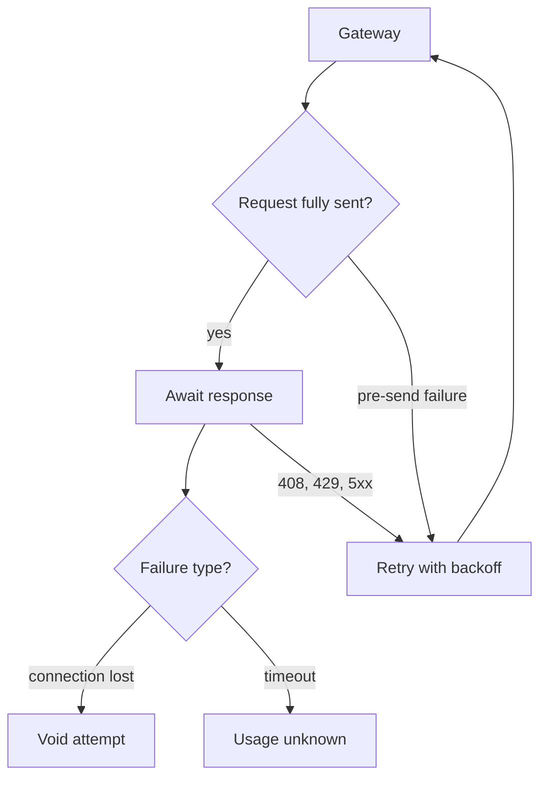

<h3>PR Summary by Qodo</h3>

Void post-send connection failures instead of retrying

<code>🐞 Bug fix</code> <code>🧪 Tests</code> <code>📝 Documentation</code> <code>🕐 10-20 Minutes</code>

AI Description

<dl>
<dd>
 

><pre>
>• Prevent duplicate provider billing by never retrying a connection lost after the full request was
>  sent.
>• Record those failures as voids while preserving pre-send and retryable-response retries.
>• Align the specification, schema descriptions, and gateway tests with the retry boundary.
></pre>

</dd>
</dl>

Diagram

<dl>
<dd>

 

</dd>
</dl>

High-Level Assessment

<dl>
<dd>

 

>Keep the send-completion boundary in the gateway: it avoids assuming the provider supports idempotency and preserves retries where a complete request was not sent or the provider explicitly returned a retryable status.

</dd>
</dl>

 Files changed (4) <code> +63 / -20 </code> 

<dl>
<dd>

 

Bug fix (1) <code> +13 / -9 </code>

<dl>
<dd>

gateway.py<code>Void connections lost after the full request was sent</code> <code>+13/-9</code>

 

>Void connections lost after the full request was sent
>
><pre>
>• In _open_upstream, a post-send connection or HTTP exception now returns failed without entering retry backoff; post-send timeouts still return timeout. Module and method documentation describe the boundary.
></pre>
>
><a href='https://github.com/SigorMatt/harness-bench/pull/2/files#diff-fef3562d0489296e808673921d86c962355faa436a870c5f670f6d49e9471f96'>hb/gateway.py</a>

</dd>
</dl>

Tests (1) <code> +38 / -2 </code>

<dl>
<dd>

test_gateway.py<code>Cover post-send voids and pre-send retries</code> <code>+38/-2</code>

 

>Cover post-send voids and pre-send retries
>
><pre>
>• Adds tests for a dropped connection after the provider receives the full request, including no retry and local responses to later requests, and for retries on refused connections before sending. Existing retry and shutdown-backoff tests use retryable HTTP statuses instead of a post-send drop.
></pre>
>
><a href='https://github.com/SigorMatt/harness-bench/pull/2/files#diff-4f0390209d7648ae2dbda296ebe43dc6e901a046b178a4e0aff1d78752ee65b7'>tests/test_gateway.py</a>

</dd>
</dl>

Documentation (2) <code> +12 / -9 </code>

<dl>
<dd>

result-bundle.md<code>Specify the post-send no-retry and void rules</code> <code>+10/-7</code>

 

>Specify the post-send no-retry and void rules
>
><pre>
>• Limits connection and TLS retries to failures before the full request was sent. Adds post-send connection loss before a response to the void causes and distinguishes it from usage_unknown timeouts.
></pre>
>
><a href='https://github.com/SigorMatt/harness-bench/pull/2/files#diff-2165efa4eeda3a5b7c8a6ab23d514b24097e696cb663a4d677b5670d0a25fd48'>docs/spec/result-bundle.md</a>

gateway-record.schema.json<code>Clarify outcomes and retry counts in record descriptions</code> <code>+2/-2</code>

 

>Clarify outcomes and retry counts in record descriptions
>
><pre>
>• Documents post-send connection loss as an upstream_failed void and clarifies which failures can contribute to upstream_attempts. The schema’s validation constraints are unchanged.
></pre>
>
><a href='https://github.com/SigorMatt/harness-bench/pull/2/files#diff-a7f4f5e48d761d3696c5ecbe3cb169b77f274e5db0ce6b40487dd4601af0f08e'>schemas/gateway-record.schema.json</a>

</dd>
</dl>

</dd>
</dl>

