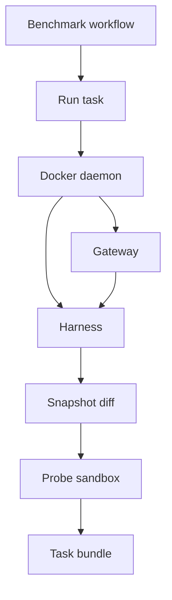

<h3>PR Summary by Qodo</h3>

Add run-task orchestration and the toolkit image

<code>✨ Enhancement</code> <code>🐞 Bug fix</code> <code>🧪 Tests</code> <code>🕐 40+ Minutes</code>

AI Description

<dl>
<dd>
 

><pre>
>• Run each task rep in fresh containers, then grade and package its results.
>• Rerun provider-voided attempts, but fail the job when gateway records cannot be trusted.
>• Add toolkit images, sandbox profiles, and Docker end-to-end coverage.
></pre>

</dd>
</dl>

Diagram

<dl>
<dd>

 

</dd>
</dl>

High-Level Assessment

<dl>
<dd>

 

>The following are alternative approaches to this PR:

<b>1. Use the Docker SDK instead of the Docker CLI</b>

<dl>
<dd>

- ➕ Offers a programmatic API for container state and streamed output.
- ➖ Adds a dependency to the trusted toolkit and does not remove the need for bounded transfers or lifecycle controls.

</dd>
</dl>

>**Recommendation:** Keep the CLI-based approach: it builds on the existing argument-list profiles and avoids a new runtime dependency. Review should concentrate on deadline enforcement, transfer bounds, cleanup, and the boundary between void attempts and job failures.

</dd>
</dl>

 Files changed (23) <code> +2689 / -49 </code> 

<dl>
<dd>

 

Enhancement (6) <code> +1084 / -4 </code>

<dl>
<dd>

__main__.py<code>Enable the hb module entrypoint</code> <code>+3/-0</code>

 

>Enable the hb module entrypoint
>
><pre>
>• Dispatches python -m hb to the toolkit CLI.
></pre>
>
><a href='https://github.com/SigorMatt/harness-bench/pull/3/files#diff-872ef0ec99d41a661e1a396ff3a1d939316d19db51d7c3ddb3d1578dcb31c2fa'>hb/__main__.py</a>

cli.py<code>Add gateway and run-task commands</code> <code>+127/-0</code>

 

>Add gateway and run-task commands
>
><pre>
>• Validates workflow-provided job identity, task, harness, and image references before constructing a task job. Handles cancellation signals so orchestrator cleanup can run.
></pre>
>
><a href='https://github.com/SigorMatt/harness-bench/pull/3/files#diff-f2671e6734edabf8b1923decffbc993d61ae9541b68d1c4609c0b4ec32cd29c6'>hb/cli.py</a>

dockercli.py<code>Add bounded Docker CLI operations</code> <code>+236/-0</code>

 

>Add bounded Docker CLI operations
>
><pre>
>• Wraps shell-free Docker commands, state inspection, container logs, tar streams, and cleanup. Adds timeouts and a bounded stdout capture path for probes.
></pre>
>
><a href='https://github.com/SigorMatt/harness-bench/pull/3/files#diff-6ebdd87af55d809d1be2c70656c71601bd39e7978668fe23babe8c4132c77e14'>hb/dockercli.py</a>

orchestrator.py<code>Run reps, grade patches, and assemble task bundles</code> <code>+458/-0</code>

 

>Run reps, grade patches, and assemble task bundles
>
><pre>
>• Creates fresh resources per attempt, enforces harness deadlines, and reruns only attempts with upstream_failed records. Snapshots accepted workspaces, grades each rep in a probe sandbox, and packages the results.
></pre>
>
><a href='https://github.com/SigorMatt/harness-bench/pull/3/files#diff-8e7c4737f7a46e821465b9e891d0783336d86dfd71d6927cac7ff112379991c7'>hb/orchestrator.py</a>

profile.py<code>Define helper, harness, gateway, and probe profiles</code> <code>+98/-4</code>

 

>Define helper, harness, gateway, and probe profiles
>
><pre>
>• Adds volume-transfer helpers and a networkless probe sandbox profile. Retains stopped harness containers for inspection and caps container logs and gateway resources.
></pre>
>
><a href='https://github.com/SigorMatt/harness-bench/pull/3/files#diff-0bb9ccd4fb708672d62fcebc3dd2d52ce7053213f548976e8600af4edbf6307c'>hb/profile.py</a>

transfer.py<code>Transfer and filter container trees as tar streams</code> <code>+162/-0</code>

 

>Transfer and filter container trees as tar streams
>
><pre>
>• Packs toolkit-made trees with fixed ownership and normalized modes. Extracts bounded workspace snapshots while retaining directories, regular files, and eligible hard links and excluding other entry types.
></pre>
>
><a href='https://github.com/SigorMatt/harness-bench/pull/3/files#diff-dc55fb09315ccea778a44ab35a3652d7c2d1190b1149ac44db8bbc6b9d972c51'>hb/transfer.py</a>

</dd>
</dl>

Bug fix (1) <code> +11 / -6 </code>

<dl>
<dd>

gateway.py<code>Clarify gateway record-write failure behavior</code> <code>+11/-6</code>

 

>Clarify gateway record-write failure behavior
>
><pre>
>• Updates gateway documentation to state that an unwritable record causes a non-zero exit and job failure, not an attempt rerun.
></pre>
>
><a href='https://github.com/SigorMatt/harness-bench/pull/3/files#diff-fef3562d0489296e808673921d86c962355faa436a870c5f670f6d49e9471f96'>hb/gateway.py</a>

</dd>
</dl>

Documentation (4) <code> +132 / -28 </code>

<dl>
<dd>

README.md<code>Document orchestrator status and Docker test setup</code> <code>+15/-6</code>

 

>Document orchestrator status and Docker test setup
>
><pre>
>• Updates the project status and layout, and explains how to run the opt-in Docker tests.
></pre>
>
><a href='https://github.com/SigorMatt/harness-bench/pull/3/files#diff-b335630551682c19a781afebcf4d07bf978fb1f8ac04c6bf87428ed5106870f5'>README.md</a>

result-bundle.md<code>Specify rep execution and job-failure semantics</code> <code>+114/-19</code>

 

>Specify rep execution and job-failure semantics
>
><pre>
>• Documents container setup, attempt lifecycle, snapshotting, probe grading, and resource limits. Changes non-zero gateway exits from void attempts to job failures to prevent harness-induced rerolls.
></pre>
>
><a href='https://github.com/SigorMatt/harness-bench/pull/3/files#diff-2165efa4eeda3a5b7c8a6ab23d514b24097e696cb663a4d677b5670d0a25fd48'>docs/spec/result-bundle.md</a>

__init__.py<code>Reflect the toolkit&#x27;s runtime modules</code> <code>+2/-2</code>

 

>Reflect the toolkit&#x27;s runtime modules
>
><pre>
>• Clarifies that the package includes the gateway, orchestrator, and CLI alongside pure reference functions.
></pre>
>
><a href='https://github.com/SigorMatt/harness-bench/pull/3/files#diff-b7514111f7c81ca69b4769aa518656d65a8dce8d5edc4267c749ea49117bffd6'>hb/__init__.py</a>

lifecycle.schema.json<code>Align lifecycle description with stopped containers</code> <code>+1/-1</code>

 

>Align lifecycle description with stopped containers
>
><pre>
>• Clarifies when the toolkit writes lifecycle records without changing the schema&#x27;s accepted values.
></pre>
>
><a href='https://github.com/SigorMatt/harness-bench/pull/3/files#diff-517290fcece44e504fd2c52770104c88de62898236247e55472caa1d81d5f2fb'>schemas/lifecycle.schema.json</a>

</dd>
</dl>

Other (12) <code> +1462 / -11 </code>

<dl>
<dd>

.dockerignore<code>Exclude development artifacts from image builds</code> <code>+9/-0</code>

 

>Exclude development artifacts from image builds
>
><pre>
>• Keeps Git metadata, CI files, caches, build output, and reviews out of the Docker build context.
></pre>
>
><a href='https://github.com/SigorMatt/harness-bench/pull/3/files#diff-2f754321d62f08ba8392b9b168b83e24ea2852bb5d815d63e767f6c3d23c6ac5'>.dockerignore</a>

bench.yml<code>Run the toolkit with cancellation forwarding</code> <code>+13/-10</code>

 

>Run the toolkit with cancellation forwarding
>
><pre>
>• Passes the pinned toolkit image reference into run-task and enables Docker init so cancellation signals reach the toolkit for cleanup. Clarifies attempt and grading behavior.
></pre>
>
><a href='https://github.com/SigorMatt/harness-bench/pull/3/files#diff-a5e740be96415373789689f814583e93ff2a8f05eae6481e94505fd6cb6bc6a7'>.github/workflows/bench.yml</a>

ci.yml<code>Test Python 3.12 and Docker integration in CI</code> <code>+30/-0</code>

 

>Test Python 3.12 and Docker integration in CI
>
><pre>
>• Adds a Python 3.12 test pass and a separate, non-required job that builds the toolkit base and runs Docker end-to-end tests.
></pre>
>
><a href='https://github.com/SigorMatt/harness-bench/pull/3/files#diff-b803fcb7f17ed9235f1e5cb1fcd2f5d3b2838429d4368ae4c57ce4436577f03f'>.github/workflows/ci.yml</a>

toolkit-base.Dockerfile<code>Provide the toolkit&#x27;s Python, Git, and Docker CLI base</code> <code>+19/-0</code>

 

>Provide the toolkit&#x27;s Python, Git, and Docker CLI base
>
><pre>
>• Builds a base image with the tools needed to diff workspaces and manage sibling containers. Documents digest-pinned release build inputs.
></pre>
>
><a href='https://github.com/SigorMatt/harness-bench/pull/3/files#diff-964e331b9c82bee6236e1b794415ff458bd2f4018dc89909ea4b99586ad2b6ed'>docker/toolkit-base.Dockerfile</a>

toolkit.Dockerfile<code>Package the toolkit with volume mount points</code> <code>+29/-0</code>

 

>Package the toolkit with volume mount points
>
><pre>
>• Copies the library, schemas, and registry into the runtime image and sets mount-point ownership for harness and gateway volumes. Makes the hb module its entrypoint.
></pre>
>
><a href='https://github.com/SigorMatt/harness-bench/pull/3/files#diff-ea95800f84872dfdf742acfc5a481562b874344e18df7c6f05fc16caa4eaaa81'>docker/toolkit.Dockerfile</a>

stub_harness.py<code>Add a scripted harness for Docker tests</code> <code>+58/-0</code>

 

>Add a scripted harness for Docker tests
>
><pre>
>• Implements the harness adapter contract and applies provider-directed workspace changes, retries, exits, or sleeps to exercise attempt outcomes.
></pre>
>
><a href='https://github.com/SigorMatt/harness-bench/pull/3/files#diff-7fd3fb5b138fb3f0241a32a9383e3be90e4551c7589c58c7fc92d9f122e62d9a'>tests/docker/stub_harness.py</a>

test_cli.py<code>Test CLI validation and cancellation handling</code> <code>+76/-0</code>

 

>Test CLI validation and cancellation handling
>
><pre>
>• Covers job construction, malformed environment inputs, command dispatch, exit codes, and signal behavior.
></pre>
>
><a href='https://github.com/SigorMatt/harness-bench/pull/3/files#diff-4e8715c7a425ee52e74b7df4d34efd32e8c92f3e60bd51bc2e1ad5943b82032e'>tests/test_cli.py</a>

test_dockercli.py<code>Test Docker wrapper failure and streaming paths</code> <code>+144/-0</code>

 

>Test Docker wrapper failure and streaming paths
>
><pre>
>• Uses a fake Docker executable to verify command checking, timeouts, output caps, streaming errors, state inspection, and removal.
></pre>
>
><a href='https://github.com/SigorMatt/harness-bench/pull/3/files#diff-136526680bd27c4afc6a03ed816e73a5403ebb9e92c234bd812eef43459d1428'>tests/test_dockercli.py</a>

test_orchestrator.py<code>Test attempt lifecycle and bundle generation</code> <code>+508/-0</code>

 

>Test attempt lifecycle and bundle generation
>
><pre>
>• Uses fake Docker and clock implementations to cover deadlines, void reruns, gateway failures, cleanup, snapshot limits, probe behavior, and bundle validation.
></pre>
>
><a href='https://github.com/SigorMatt/harness-bench/pull/3/files#diff-b7bee22c77a95070efe5c3b208a32f511bbb6ac893ff3643d2d3587c000fe069'>tests/test_orchestrator.py</a>

test_profile.py<code>Assert new container isolation profiles</code> <code>+65/-1</code>

 

>Assert new container isolation profiles
>
><pre>
>• Checks helper mounts, harness retention, gateway and log limits, probe isolation, and resource-name separation.
></pre>
>
><a href='https://github.com/SigorMatt/harness-bench/pull/3/files#diff-35022cdf6e06ddc9bb492227884ed930c7b3a7499b84b7f669be327298b8692c'>tests/test_profile.py</a>

test_run_task_docker.py<code>Exercise run-task against a real Docker daemon</code> <code>+368/-0</code>

 

>Exercise run-task against a real Docker daemon
>
><pre>
>• Adds opt-in end-to-end tests with built toolkit and harness images and a TLS stub provider. Verifies bundles, reruns, deadlines, sandbox output limits, and the toolkit-container deployment path.
></pre>
>
><a href='https://github.com/SigorMatt/harness-bench/pull/3/files#diff-091eac90697dc045a5dbec15548988e1769eec2765296b8aa8f8becc0e597b72'>tests/test_run_task_docker.py</a>

test_transfer.py<code>Test tar safety, limits, and normalization</code> <code>+143/-0</code>

 

>Test tar safety, limits, and normalization
>
><pre>
>• Covers supported and skipped archive entries, unsafe paths, hard-link size accounting, malformed streams, and deterministic input tar metadata.
></pre>
>
><a href='https://github.com/SigorMatt/harness-bench/pull/3/files#diff-7561db2c9cfd5a635868bc385fdd188133919cfec79adbc4344ab21933aa95a0'>tests/test_transfer.py</a>

</dd>
</dl>

</dd>
</dl>

