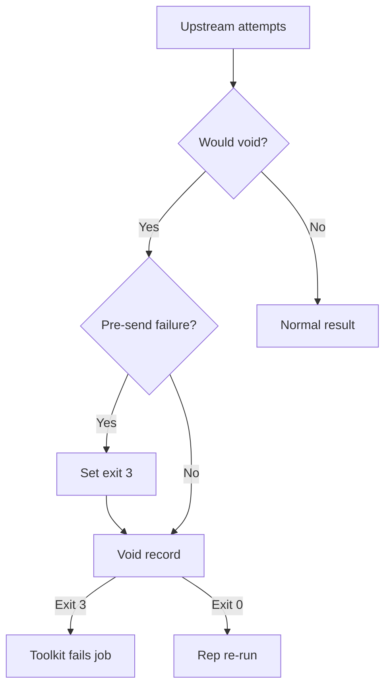

<h3>PR Summary by Qodo</h3>

Fail jobs when a provider connection failure would void a request

<code>🐞 Bug fix</code> <code>🧪 Tests</code> <code>📝 Documentation</code> <code>🕐 20-40 Minutes</code>

AI Description

<dl>
<dd>
 

><pre>
>• Fail the job when a request would void after any attempt failed before sending, preventing
>  harness-triggered re-rolls.
>• Preserve void records and local responses, but use gateway exit status 3 to stop re-runs.
>• Clarify toolkit errors and document the policy, with gateway, orchestrator, and Docker tests.
></pre>

</dd>
</dl>

Diagram

<dl>
<dd>

 

</dd>
</dl>

High-Level Assessment

<dl>
<dd>

 

>The following are alternative approaches to this PR:

<b>1. Isolate harness traffic before connection tracking</b>

<dl>
<dd>

- ➕ Could prevent the identified connection-tracking exhaustion route without failing otherwise recoverable jobs.
- ➖ Requires runner-level network controls and does not by itself address every pre-send failure a harness might cause.

</dd>
</dl>

>**Recommendation:** Keep the exit-status policy: it closes the re-roll path for any pre-send failure followed by a void, without relying on identifying its cause. Network isolation could be added later to improve availability, but should not replace the failure policy without equivalent coverage.

</dd>
</dl>

 Files changed (8) <code> +267 / -49 </code> 

<dl>
<dd>

 

Enhancement (1) <code> +23 / -4 </code>

<dl>
<dd>

orchestrator.py<code>Explain non-zero gateway exits when failing a job</code> <code>+23/-4</code>

 

>Explain non-zero gateway exits when failing a job
>
><pre>
>• Keeps the existing exit-status check ahead of void-record handling. Adds status-specific failure reasons and the tail of gateway output when available.
></pre>
>
><a href='https://github.com/SigorMatt/harness-bench/pull/4/files#diff-8e7c4737f7a46e821465b9e891d0783336d86dfd71d6927cac7ff112379991c7'>hb/orchestrator.py</a>

</dd>
</dl>

Bug fix (1) <code> +49 / -12 </code>

<dl>
<dd>

gateway.py<code>Exit with status 3 for voids following pre-send failures</code> <code>+49/-12</code>

 

>Exit with status 3 for voids following pre-send failures
>
><pre>
>• Tracks connection, TLS, and send failures across a request&#x27;s attempts and marks the gateway unreachable if that request would void. Preserves the void record and response while returning status 3 at shutdown, with record-write failure retaining precedence.
></pre>
>
><a href='https://github.com/SigorMatt/harness-bench/pull/4/files#diff-fef3562d0489296e808673921d86c962355faa436a870c5f670f6d49e9471f96'>hb/gateway.py</a>

</dd>
</dl>

Tests (3) <code> +161 / -13 </code>

<dl>
<dd>

test_gateway.py<code>Cover unreachable attempts and gateway exit status</code> <code>+112/-12</code>

 

>Cover unreachable attempts and gateway exit status
>
><pre>
>• Tests exhausted connections, failed TLS handshakes, later failures in the same request, and status ordering before a void record. Also verifies successful retries, shutdown during backoff, local responses, and provider-reached voids retain their intended behavior.
></pre>
>
><a href='https://github.com/SigorMatt/harness-bench/pull/4/files#diff-4f0390209d7648ae2dbda296ebe43dc6e901a046b178a4e0aff1d78752ee65b7'>tests/test_gateway.py</a>

test_orchestrator.py<code>Verify exit 3 prevents a rep re-run</code> <code>+32/-0</code>

 

>Verify exit 3 prevents a rep re-run
>
><pre>
>• Checks that an unreachable-provider exit fails the job despite an upstream_failed record and includes gateway output in the error. Covers the fallback message when gateway logs cannot be read.
></pre>
>
><a href='https://github.com/SigorMatt/harness-bench/pull/4/files#diff-b7bee22c77a95070efe5c3b208a32f511bbb6ac893ff3643d2d3587c000fe069'>tests/test_orchestrator.py</a>

test_run_task_docker.py<code>Exercise unreachable-provider failure in Docker</code> <code>+17/-1</code>

 

>Exercise unreachable-provider failure in Docker
>
><pre>
>• Adds an integration test using an unserved provider port. It expects a job failure without a re-run or output bundle and checks that containers are cleaned up.
></pre>
>
><a href='https://github.com/SigorMatt/harness-bench/pull/4/files#diff-091eac90697dc045a5dbec15548988e1769eec2765296b8aa8f8becc0e597b72'>tests/test_run_task_docker.py</a>

</dd>
</dl>

Documentation (3) <code> +34 / -20 </code>

<dl>
<dd>

result-bundle.md<code>Specify when provider reachability fails a job</code> <code>+32/-18</code>

 

>Specify when provider reachability fails a job
>
><pre>
>• Defines the request-wide pre-send failure rule, exit status 3, and its effect on re-runs. Moves connection-tracking exhaustion from an open residual risk to the documented job failures a harness can cause.
></pre>
>
><a href='https://github.com/SigorMatt/harness-bench/pull/4/files#diff-2165efa4eeda3a5b7c8a6ab23d514b24097e696cb663a4d677b5670d0a25fd48'>docs/spec/result-bundle.md</a>

profile.py<code>Correct the gateway resource-limit comment</code> <code>+1/-1</code>

 

>Correct the gateway resource-limit comment
>
><pre>
>• Clarifies that a failed upstream connection would now fail the job rather than void the attempt.
></pre>
>
><a href='https://github.com/SigorMatt/harness-bench/pull/4/files#diff-0bb9ccd4fb708672d62fcebc3dd2d52ce7053213f548976e8600af4edbf6307c'>hb/profile.py</a>

gateway-record.schema.json<code>Document the exception to upstream_failed re-runs</code> <code>+1/-1</code>

 

>Document the exception to upstream_failed re-runs
>
><pre>
>• Explains that an upstream_failed record does not cause a re-run when an attempt failed before sending: gateway exit status 3 fails the job instead. The outcome enum is unchanged.
></pre>
>
><a href='https://github.com/SigorMatt/harness-bench/pull/4/files#diff-a7f4f5e48d761d3696c5ecbe3cb169b77f274e5db0ce6b40487dd4601af0f08e'>schemas/gateway-record.schema.json</a>

</dd>
</dl>

</dd>
</dl>

