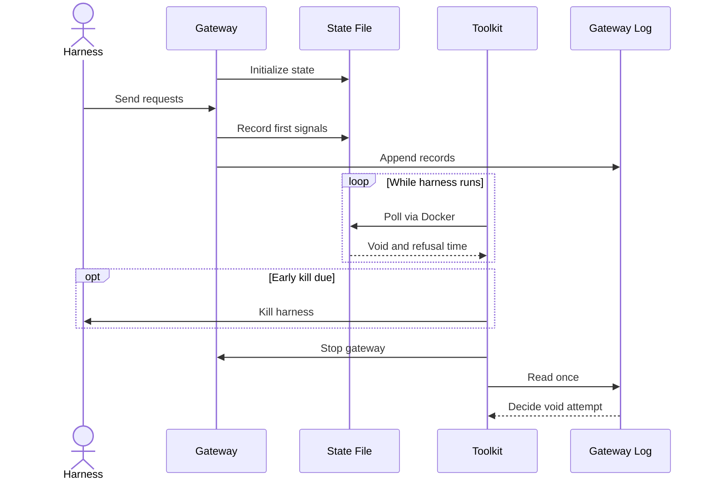

<h3>PR Summary by Qodo</h3>

Time early harness kills from gateway state instead of its growing log

<code>✨ Enhancement</code> <code>🐞 Bug fix</code> <code>🧪 Tests</code> <code>📝 Documentation</code> <code>🕐 40+ Minutes</code>

AI Description

<dl>
<dd>
 

><pre>
>• Poll a bounded gateway state file to time void and budget-refusal kills without repeatedly copying
>  the log.
>• Preserve the final log as the authority for void attempts and fail the job on state-write errors.
>• Document the state contract and test polling, deadlines, failure handling, and gateway
>  configuration.
></pre>

</dd>
</dl>

Diagram

<dl>
<dd>

 

</dd>
</dl>

High-Level Assessment

<dl>
<dd>

 

>The following are alternative approaches to this PR:

<b>1. Incrementally tail the gateway log</b>

<dl>
<dd>

- ➕ Keeps one source of early-kill signals and final records.
- ➖ Requires a way to read byte ranges from the gateway-only volume and handle incomplete lines and offsets.

</dd>
</dl>

>**Recommendation:** Use the state file for this PR: it makes poll cost independent of log growth while leaving the final log authoritative. Incremental tailing avoids a second representation but adds Docker access and stream-parsing complexity.

</dd>
</dl>

 Files changed (8) <code> +331 / -102 </code> 

<dl>
<dd>

 

Enhancement (2) <code> +111 / -9 </code>

<dl>
<dd>

gateway.py<code>Publish atomic gateway state for early-kill signals</code> <code>+86/-9</code>

 

>Publish atomic gateway state for early-kill signals
>
><pre>
>• Adds optional --state support, initializes the file at startup, and records the first void and budget refusal through serialized atomic replacements. Startup creation errors prevent launch; later write errors make the gateway exit unsuccessfully.
></pre>
>
><a href='https://github.com/SigorMatt/harness-bench/pull/5/files#diff-fef3562d0489296e808673921d86c962355faa436a870c5f670f6d49e9471f96'>hb/gateway.py</a>

gateway-state.schema.json<code>Define the gateway state contract</code> <code>+25/-0</code>

 

>Define the gateway state contract
>
><pre>
>• Defines the schema identifier, boolean void flag, and nullable epoch-millisecond timestamp for the first budget refusal.
></pre>
>
><a href='https://github.com/SigorMatt/harness-bench/pull/5/files#diff-5fe67a6825f707c419d4c2912d7e2b22593e7c79f88685721625ad4889c37a0d'>schemas/gateway-state.schema.json</a>

</dd>
</dl>

Bug fix (1) <code> +54 / -47 </code>

<dl>
<dd>

orchestrator.py<code>Poll gateway state instead of copying the live log</code> <code>+54/-47</code>

 

>Poll gateway state instead of copying the live log
>
><pre>
>• Replaces live-log tailing with bounded, validated state-file reads for early-kill timing and reports five consecutive read failures. Retains the single post-stop log read as the authority for void attempts.
></pre>
>
><a href='https://github.com/SigorMatt/harness-bench/pull/5/files#diff-8e7c4737f7a46e821465b9e891d0783336d86dfd71d6927cac7ff112379991c7'>hb/orchestrator.py</a>

</dd>
</dl>

Tests (3) <code> +139 / -26 </code>

<dl>
<dd>

test_gateway.py<code>Test gateway state publication and failures</code> <code>+80/-1</code>

 

>Test gateway state publication and failures
>
><pre>
>• Runs gateway fixtures with a state file and checks startup contents, void ordering, first-refusal retention, and schema validity. Covers startup creation failure and fatal write failures for both signals.
></pre>
>
><a href='https://github.com/SigorMatt/harness-bench/pull/5/files#diff-4f0390209d7648ae2dbda296ebe43dc6e901a046b178a4e0aff1d78752ee65b7'>tests/test_gateway.py</a>

test_orchestrator.py<code>Test state polling and final-log behavior</code> <code>+57/-25</code>

 

>Test state polling and final-log behavior
>
><pre>
>• Extends fake Docker copies to provide state and simulate slow or failed reads. Verifies strict parsing, deadline preservation, one log copy per attempt, read-failure warnings, and final-log void decisions.
></pre>
>
><a href='https://github.com/SigorMatt/harness-bench/pull/5/files#diff-b7bee22c77a95070efe5c3b208a32f511bbb6ac893ff3643d2d3587c000fe069'>tests/test_orchestrator.py</a>

test_profile.py<code>Assert gateway state path is configured</code> <code>+2/-0</code>

 

>Assert gateway state path is configured
>
><pre>
>• Checks that gateway container arguments include both the log path and the new state path.
></pre>
>
><a href='https://github.com/SigorMatt/harness-bench/pull/5/files#diff-35022cdf6e06ddc9bb492227884ed930c7b3a7499b84b7f669be327298b8692c'>tests/test_profile.py</a>

</dd>
</dl>

Documentation (1) <code> +26 / -20 </code>

<dl>
<dd>

result-bundle.md<code>Specify state-based early kills</code> <code>+26/-20</code>

 

>Specify state-based early kills
>
><pre>
>• Documents the state file, its write-failure behavior, and its role in timing early kills. Updates the container example and removes the obsolete limitation about repeatedly reading the gateway log.
></pre>
>
><a href='https://github.com/SigorMatt/harness-bench/pull/5/files#diff-2165efa4eeda3a5b7c8a6ab23d514b24097e696cb663a4d677b5670d0a25fd48'>docs/spec/result-bundle.md</a>

</dd>
</dl>

Other (1) <code> +1 / -0 </code>

<dl>
<dd>

profile.py<code>Enable the state file in the gateway container</code> <code>+1/-0</code>

 

>Enable the state file in the gateway container
>
><pre>
>• Passes --state /log/state.json alongside the gateway log path on the gateway&#x27;s existing volume.
></pre>
>
><a href='https://github.com/SigorMatt/harness-bench/pull/5/files#diff-0bb9ccd4fb708672d62fcebc3dd2d52ce7053213f548976e8600af4edbf6307c'>hb/profile.py</a>

</dd>
</dl>

</dd>
</dl>

