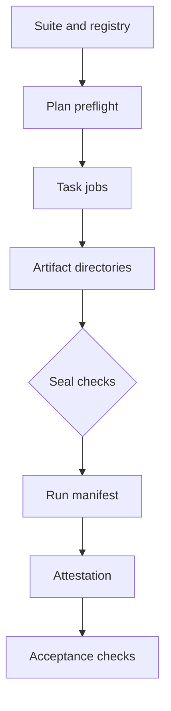

<h3>PR Summary by Qodo</h3>

Add plan and seal commands to the benchmark workflow

<code>✨ Enhancement</code> <code>🧪 Tests</code> <code>📝 Documentation</code> <code>🕐 40+ Minutes</code>

AI Description

<dl>
<dd>
 

><pre>
>• Add preflight planning to reject un-runnable suites and re-run attempts before task jobs start.
>• Seal only complete, verified task bundles into an attestable run manifest.
>• Align artifact downloads with acceptance paths and cover the commands with functional tests.
></pre>

</dd>
</dl>

Diagram

<dl>
<dd>

 

</dd>
</dl>

High-Level Assessment

<dl>
<dd>

 

>Keep preflight and sealing in the pinned toolkit, while leaving attestation verification and re-grading to acceptance. Sharing the artifact-path and attempt-limit helpers prevents those rules from drifting without treating sealing as a new trust boundary.

</dd>
</dl>

 Files changed (12) <code> +793 / -57 </code> 

<dl>
<dd>

 

Enhancement (5) <code> +340 / -35 </code>

<dl>
<dd>

bench.yml<code>Wire preflight inputs and isolated bundle downloads</code> <code>+20/-9</code>

 

>Wire preflight inputs and isolated bundle downloads
>
><pre>
>• Pass the run attempt to plan and release image references to seal. Download bundles into separate artifact directories so seal reads the same paths as acceptance.
></pre>
>
><a href='https://github.com/SigorMatt/harness-bench/pull/6/files#diff-a5e740be96415373789689f814583e93ff2a8f05eae6481e94505fd6cb6bc6a7'>.github/workflows/bench.yml</a>

cli.py<code>Expose plan and seal commands and reject re-run attempts</code> <code>+117/-22</code>

 

>Expose plan and seal commands and reject re-run attempts
>
><pre>
>• Add CLI entry points that validate environment inputs and write workflow outputs. Share registry lookup and first-attempt validation with run-task.
></pre>
>
><a href='https://github.com/SigorMatt/harness-bench/pull/6/files#diff-f2671e6734edabf8b1923decffbc993d61ae9541b68d1c4609c0b4ec32cd29c6'>hb/cli.py</a>

manifest.py<code>Allow bundle extraction from an open file</code> <code>+7/-3</code>

 

>Allow bundle extraction from an open file
>
><pre>
>• Extend &#x27;extract_bundle&#x27; to accept a binary file object, allowing seal to hash and extract through the same open archive.
></pre>
>
><a href='https://github.com/SigorMatt/harness-bench/pull/6/files#diff-4ba6c72983ce61b5dedce528bf6c5d54f76d3b97c7bf57d1947f8f762d064b8c'>hb/manifest.py</a>

plan.py<code>Validate suites and derive the task matrix</code> <code>+56/-1</code>

 

>Validate suites and derive the task matrix
>
><pre>
>• Check task ordering, uniqueness, slug format, matrix size and listed task files. Return the task IDs and a hosted-job-compatible timeout.
></pre>
>
><a href='https://github.com/SigorMatt/harness-bench/pull/6/files#diff-19782370be3ee656dae79282a5c795254c797423e8b97d1b69d832fd907b49d5'>hb/plan.py</a>

seal.py<code>Verify task bundles before constructing a run manifest</code> <code>+140/-0</code>

 

>Verify task bundles before constructing a run manifest
>
><pre>
>• Recompute cohort and entry identity, verify each expected archive and lifecycle, and enforce suite attempt limits. Return a manifest containing bundle digests and sizes only after all checks pass.
></pre>
>
><a href='https://github.com/SigorMatt/harness-bench/pull/6/files#diff-d3419ad40e393e83ca92f389e3319391c60a516d83ece4e2f0ffcb67c75f1448'>hb/seal.py</a>

</dd>
</dl>

Refactor (2) <code> +19 / -11 </code>

<dl>
<dd>

accept.py<code>Share the downloaded bundle path convention</code> <code>+8/-1</code>

 

>Share the downloaded bundle path convention
>
><pre>
>• Introduce &#x27;bundle_artifact_file&#x27; and use it when listing the files acceptance expects. Seal uses the same helper to locate each task bundle.
></pre>
>
><a href='https://github.com/SigorMatt/harness-bench/pull/6/files#diff-4dd8ae2d2c87736c37fd278fa972d6aa6d365b83a67f0f80796660c33b8d2665'>hb/accept.py</a>

make_examples.py<code>Generate the example manifest through seal</code> <code>+11/-10</code>

 

>Generate the example manifest through seal
>
><pre>
>• Package the example bundle under its downloaded-artifact path and call &#x27;seal_run&#x27; instead of independently assembling the run manifest.
></pre>
>
><a href='https://github.com/SigorMatt/harness-bench/pull/6/files#diff-7554577b87a5c11159a02eea673c05fbb7f4c8de83b2266a1c20d845873a5ed4'>scripts/make_examples.py</a>

</dd>
</dl>

Tests (3) <code> +379 / -2 </code>

<dl>
<dd>

test_cli.py<code>Cover re-run rejection and unknown CLI commands</code> <code>+2/-1</code>

 

>Cover re-run rejection and unknown CLI commands
>
><pre>
>• Add a run-task environment case for a second attempt and adjust the unknown-command test now that seal is supported.
></pre>
>
><a href='https://github.com/SigorMatt/harness-bench/pull/6/files#diff-4e8715c7a425ee52e74b7df4d34efd32e8c92f3e60bd51bc2e1ad5943b82032e'>tests/test_cli.py</a>

test_run_task_docker.py<code>Exercise plan and seal inside the toolkit image</code> <code>+39/-1</code>

 

>Exercise plan and seal inside the toolkit image
>
><pre>
>• Run both commands in network-isolated containers with workflow-style mounts. Compare the sealed output byte-for-byte with the committed example manifest.
></pre>
>
><a href='https://github.com/SigorMatt/harness-bench/pull/6/files#diff-091eac90697dc045a5dbec15548988e1769eec2765296b8aa8f8becc0e597b72'>tests/test_run_task_docker.py</a>

test_seal.py<code>Test planning, sealing and refusal cases</code> <code>+338/-0</code>

 

>Test planning, sealing and refusal cases
>
><pre>
>• Cover successful command output and invalid suites, bundles, identities, lifecycle records, attempt counts and re-run attempts. Assert that sealing the example reproduces its committed manifest.
></pre>
>
><a href='https://github.com/SigorMatt/harness-bench/pull/6/files#diff-376cd29c1e109bf6cc7409eb873c53ed61819cde8d9fd2ec8a15c58196188593'>tests/test_seal.py</a>

</dd>
</dl>

Documentation (2) <code> +55 / -9 </code>

<dl>
<dd>

README.md<code>Describe the toolkit&#x27;s completed workflow commands</code> <code>+9/-7</code>

 

>Describe the toolkit&#x27;s completed workflow commands
>
><pre>
>• Update repository status to include plan and seal, while noting that release image pins and other release components remain outstanding.
></pre>
>
><a href='https://github.com/SigorMatt/harness-bench/pull/6/files#diff-b335630551682c19a781afebcf4d07bf978fb1f8ac04c6bf87428ed5106870f5'>README.md</a>

result-bundle.md<code>Specify planning and sealing checks</code> <code>+46/-2</code>

 

>Specify planning and sealing checks
>
><pre>
>• Document the command inputs, pre-attestation checks and first-attempt rule. Clarify that acceptance still verifies attestations and performs its own checks.
></pre>
>
><a href='https://github.com/SigorMatt/harness-bench/pull/6/files#diff-2165efa4eeda3a5b7c8a6ab23d514b24097e696cb663a4d677b5670d0a25fd48'>docs/spec/result-bundle.md</a>

</dd>
</dl>

</dd>
</dl>

