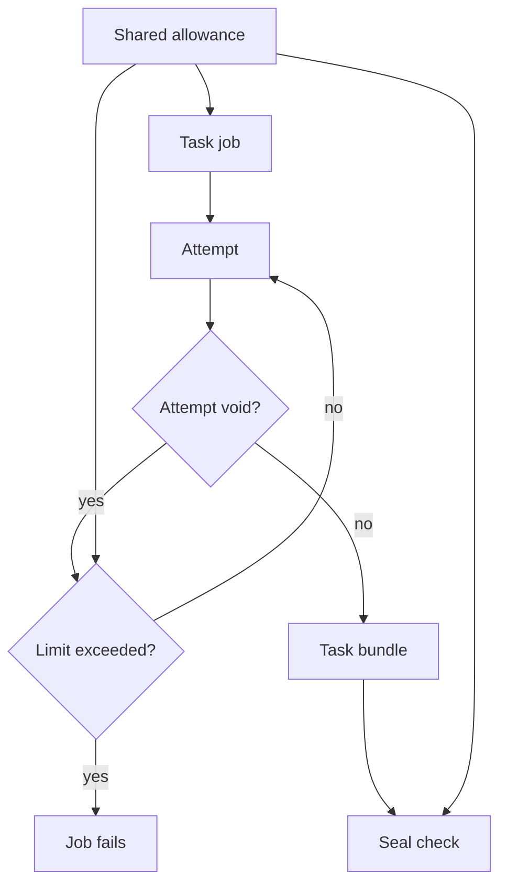

<h3>PR Summary by Qodo</h3>

Stop task jobs before exceeding the run-wide infra re-run cap

<code>🐞 Bug fix</code> <code>🧪 Tests</code> <code>📝 Documentation</code> <code>🕐 40+ Minutes</code>

AI Description

<dl>
<dd>
 

><pre>
>• Fail a task job when its own re-runs would exceed the run-wide allowance.
>• Share the allowance calculation between task jobs and seal validation.
>• Test both re-run limits and document when a void fails the job.
></pre>

</dd>
</dl>

Diagram

<dl>
<dd>

 

</dd>
</dl>

High-Level Assessment

<dl>
<dd>

 

>The following are alternative approaches to this PR:

<b>1. Coordinate a live cap across task jobs</b>

<dl>
<dd>

- ➕ Could stop re-runs earlier when separate jobs collectively exhaust the cap.
- ➖ Requires shared mutable state and coordination between jobs, adding failure and concurrency risks.

</dd>
</dl>

>**Recommendation:** Keep the PR&#x27;s conservative job-local check and retain seal as the authority for the complete run. A job&#x27;s own re-runs are a safe lower bound, while cross-job coordination adds substantial complexity for an additional early-stop opportunity.

</dd>
</dl>

 Files changed (6) <code> +190 / -43 </code> 

<dl>
<dd>

 

Bug fix (2) <code> +44 / -11 </code>

<dl>
<dd>

accept.py<code>Centralize the run-wide re-run allowance</code> <code>+10/-2</code>

 

>Centralize the run-wide re-run allowance
>
><pre>
>• Adds a floor-rounded allowance calculation and uses it for seal&#x27;s re-run budget check. The resulting acceptance rule is equivalent to the previous inequality.
></pre>
>
><a href='https://github.com/SigorMatt/harness-bench/pull/7/files#diff-4dd8ae2d2c87736c37fd278fa972d6aa6d365b83a67f0f80796660c33b8d2665'>hb/accept.py</a>

orchestrator.py<code>Fail task jobs before an unaffordable re-run</code> <code>+34/-9</code>

 

>Fail task jobs before an unaffordable re-run
>
><pre>
>• Computes the run-wide allowance from all tasks and reps, then tracks this job&#x27;s remaining allowance across reps. A void fails the job before another attempt if either limit would be exceeded, reporting the per-rep limit first when both apply.
></pre>
>
><a href='https://github.com/SigorMatt/harness-bench/pull/7/files#diff-8e7c4737f7a46e821465b9e891d0783336d86dfd71d6927cac7ff112379991c7'>hb/orchestrator.py</a>

</dd>
</dl>

Tests (3) <code> +116 / -12 </code>

<dl>
<dd>

test_accept.py<code>Verify allowance rounding and acceptance equivalence</code> <code>+19/-1</code>

 

>Verify allowance rounding and acceptance equivalence
>
><pre>
>• Tests representative allowance values and compares the shared calculation and seal check against the original cap inequality across rep counts and cap settings.
></pre>
>
><a href='https://github.com/SigorMatt/harness-bench/pull/7/files#diff-cdae29800a22fb995a3ec0d1a61e607aa061b08f12a1bf4e28f75850aa847b82'>tests/test_accept.py</a>

test_orchestrator.py<code>Cover early failure and both re-run limits</code> <code>+92/-10</code>

 

>Cover early failure and both re-run limits
>
><pre>
>• Adds cases for an immediately exhausted run cap, allowance carried across reps, successful permitted re-runs, and per-rep precedence. Adjusts existing void tests to use suites that permit re-runs and checks attempt cleanup and the absence of a bundle on failure.
></pre>
>
><a href='https://github.com/SigorMatt/harness-bench/pull/7/files#diff-b7bee22c77a95070efe5c3b208a32f511bbb6ac893ff3643d2d3587c000fe069'>tests/test_orchestrator.py</a>

test_run_task_docker.py<code>Permit a re-run in the Docker integration scenario</code> <code>+5/-1</code>

 

>Permit a re-run in the Docker integration scenario
>
><pre>
>• Pads the integration suite&#x27;s task list and raises its permille cap so its provider-side void can still be re-run under the new job check.
></pre>
>
><a href='https://github.com/SigorMatt/harness-bench/pull/7/files#diff-091eac90697dc045a5dbec15548988e1769eec2765296b8aa8f8becc0e597b72'>tests/test_run_task_docker.py</a>

</dd>
</dl>

Documentation (1) <code> +30 / -20 </code>

<dl>
<dd>

result-bundle.md<code>Specify early task-job failure at the run-wide cap</code> <code>+30/-20</code>

 

>Specify early task-job failure at the run-wide cap
>
><pre>
>• Clarifies when a void fails a task job rather than triggering another attempt, including the job-local nature of the check. Updates the timeout discussion without changing its planned allowance for attempts.
></pre>
>
><a href='https://github.com/SigorMatt/harness-bench/pull/7/files#diff-2165efa4eeda3a5b7c8a6ab23d514b24097e696cb663a4d677b5670d0a25fd48'>docs/spec/result-bundle.md</a>

</dd>
</dl>

</dd>
</dl>

