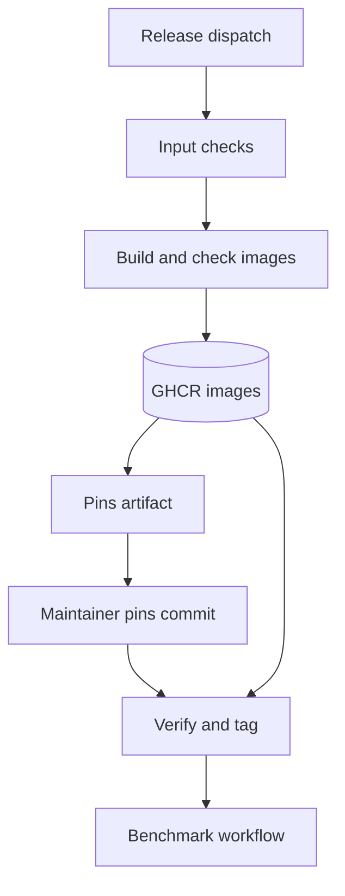

<h3>PR Summary by Qodo</h3>

Add a verified toolkit and suite image release pipeline

<code>✨ Enhancement</code> <code>⚙️ Configuration changes</code> <code>🧪 Tests</code> <code>📝 Documentation</code> <code>🕐 40+ Minutes</code>

AI Description

<dl>
<dd>
 

><pre>
>• Build, check, publish, and attest digest-pinned toolkit and suite images from main.
>• Provide maintainer commands to pin images and verify the tag-only release commit.
>• Derive release-table entries from committed bytes and document the release process.
></pre>

</dd>
</dl>

Diagram

<dl>
<dd>

 

</dd>
</dl>

High-Level Assessment

<dl>
<dd>

 

>The following are alternative approaches to this PR:

<b>1. Automate the release commit with separate credentials</b>

<dl>
<dd>

- ➕ Removes the manual pin, verify, and tag handoff.
- ➖ Requires a separately managed write credential for workflow files.
- ➖ Expands the authority of release automation and its failure modes.

</dd>
</dl>

>**Recommendation:** Keep the maintainer-created, tag-only commit: it avoids granting the publishing workflow authority to change workflow files while retaining explicit checks that the commit pins the images built from its parent. The manual handoff should remain prominent in release instructions.

</dd>
</dl>

 Files changed (15) <code> +1456 / -40 </code> 

<dl>
<dd>

 

Enhancement (3) <code> +539 / -0 </code>

<dl>
<dd>

suite.Dockerfile<code>Package the suite tree in a scratch image</code> <code>+16/-0</code>

 

>Package the suite tree in a scratch image
>
><pre>
>• Copies the suite build context to /suite without adding a runtime, matching how the benchmark workflow extracts it.
></pre>
>
><a href='https://github.com/SigorMatt/harness-bench/pull/8/files#diff-5a123feb33b9bfcc4093c1ed728098f210c3677e0814d14518d65696d4d3897e'>docker/suite.Dockerfile</a>

release.py<code>Implement release validation and committed-byte derivation</code> <code>+343/-0</code>

 

>Implement release validation and committed-byte derivation
>
><pre>
>• Adds input and image-pin validation, Git-plumbing checks for the release commit, provenance verification commands, and release-table entry generation from committed files.
></pre>
>
><a href='https://github.com/SigorMatt/harness-bench/pull/8/files#diff-dffdbb27cb5ed15cd9c455959d38dd9cb968826603c23d04c7089df62dd56a05'>hb/release.py</a>

release.py<code>Expose workflow and maintainer release commands</code> <code>+180/-0</code>

 

>Expose workflow and maintainer release commands
>
><pre>
>• Adds commands to validate inputs, name images, write pins, create the pin-only workflow change, verify a release commit and its images, and print its release-table entry.
></pre>
>
><a href='https://github.com/SigorMatt/harness-bench/pull/8/files#diff-89ed454114d0872b1f47e4be4810fc351f5b8a09b82c9ee1b1b064f175bfa4b8'>scripts/release.py</a>

</dd>
</dl>

Bug fix (1) <code> +6 / -2 </code>

<dl>
<dd>

toolkit.Dockerfile<code>Reject an invalid copied registry during build</code> <code>+6/-2</code>

 

>Reject an invalid copied registry during build
>
><pre>
>• Checks that the copied registry is a JSON document with the expected schema, preventing an empty registry-file argument from silently copying a directory.
></pre>
>
><a href='https://github.com/SigorMatt/harness-bench/pull/8/files#diff-ea95800f84872dfdf742acfc5a481562b874344e18df7c6f05fc16caa4eaaa81'>docker/toolkit.Dockerfile</a>

</dd>
</dl>

Refactor (1) <code> +5 / -12 </code>

<dl>
<dd>

make_examples.py<code>Generate example releases with shared logic</code> <code>+5/-12</code>

 

>Generate example releases with shared logic
>
><pre>
>• Uses the new release-entry function instead of maintaining a separate implementation of the example release record.
></pre>
>
><a href='https://github.com/SigorMatt/harness-bench/pull/8/files#diff-7554577b87a5c11159a02eea673c05fbb7f4c8de83b2266a1c20d845873a5ed4'>scripts/make_examples.py</a>

</dd>
</dl>

Tests (2) <code> +557 / -1 </code>

<dl>
<dd>

test_release.py<code>Exercise release inputs, pins, verification, and entries</code> <code>+521/-0</code>

 

>Exercise release inputs, pins, verification, and entries
>
><pre>
>• Adds CLI and Git-fixture tests for invalid inputs, pin-only commits, unusual paths and Git settings, anonymous pulls, provenance command arguments, and committed-byte release entries.
></pre>
>
><a href='https://github.com/SigorMatt/harness-bench/pull/8/files#diff-5614bdd8567cb2d34c39f4c8592ae23121af38ce2ef744ddb0640352f825e926'>tests/test_release.py</a>

test_run_task_docker.py<code>Test suite extraction and registry build failure</code> <code>+36/-1</code>

 

>Test suite extraction and registry build failure
>
><pre>
>• Adds Docker tests confirming that suite extraction preserves ignored files and that a toolkit build without a registry file fails.
></pre>
>
><a href='https://github.com/SigorMatt/harness-bench/pull/8/files#diff-091eac90697dc045a5dbec15548988e1769eec2765296b8aa8f8becc0e597b72'>tests/test_run_task_docker.py</a>

</dd>
</dl>

Documentation (4) <code> +129 / -18 </code>

<dl>
<dd>

bench.yml<code>Clarify placeholder and release image pins</code> <code>+5/-3</code>

 

>Clarify placeholder and release image pins
>
><pre>
>• Explains that main retains placeholder image digests and only a tag-only release commit pins published images. Identifies the two lines rewritten by the release command.
></pre>
>
><a href='https://github.com/SigorMatt/harness-bench/pull/8/files#diff-a5e740be96415373789689f814583e93ff2a8f05eae6481e94505fd6cb6bc6a7'>.github/workflows/bench.yml</a>

README.md<code>Document release status and maintainer steps</code> <code>+28/-10</code>

 

>Document release status and maintainer steps
>
><pre>
>• Describes the completed pipeline, the suite and registry still needed for a first release, and the ruleset, package visibility, and tag-only release procedure.
></pre>
>
><a href='https://github.com/SigorMatt/harness-bench/pull/8/files#diff-b335630551682c19a781afebcf4d07bf978fb1f8ac04c6bf87428ed5106870f5'>README.md</a>

result-bundle.md<code>Specify image provenance and release commits</code> <code>+92/-3</code>

 

>Specify image provenance and release commits
>
><pre>
>• Defines the build and release commits, image checks, attestation verification, tag-only publication, and release-table derivation in the result-bundle specification.
></pre>
>
><a href='https://github.com/SigorMatt/harness-bench/pull/8/files#diff-2165efa4eeda3a5b7c8a6ab23d514b24097e696cb663a4d677b5670d0a25fd48'>docs/spec/result-bundle.md</a>

submit-caller.yml<code>Clarify caller pinning to the release commit</code> <code>+4/-2</code>

 

>Clarify caller pinning to the release commit
>
><pre>
>• Instructs submitters to use the full release commit SHA rather than a branch or annotated tag name.
></pre>
>
><a href='https://github.com/SigorMatt/harness-bench/pull/8/files#diff-0dedcafe6279e10dbb1bd737a0130d7ffa764fb8832b5b0733b3f36cf915b4ab'>templates/submit-caller.yml</a>

</dd>
</dl>

Other (4) <code> +220 / -7 </code>

<dl>
<dd>

ci.yml<code>Limit push CI to branches</code> <code>+4/-0</code>

 

>Limit push CI to branches
>
><pre>
>• Prevents tag-only release commits, whose image pins differ from main&#x27;s placeholders, from triggering branch CI.
></pre>
>
><a href='https://github.com/SigorMatt/harness-bench/pull/8/files#diff-b803fcb7f17ed9235f1e5cb1fcd2f5d3b2838429d4368ae4c57ce4436577f03f'>.github/workflows/ci.yml</a>

release.yml<code>Build, publish, and attest release images</code> <code>+206/-0</code>

 

>Build, publish, and attest release images
>
><pre>
>• Adds separate input-validation and image-publishing jobs. Checks image contents and planning behavior, publishes digest-addressed images with provenance, and uploads pins plus maintainer instructions.
></pre>
>
><a href='https://github.com/SigorMatt/harness-bench/pull/8/files#diff-87db21a973eed4fef5f32b267aa60fcee5cbdf03c67fafdc2a9b553bb0b15f34'>.github/workflows/release.yml</a>

suite.Dockerfile.dockerignore<code>Preserve every suite file in the image build</code> <code>+2/-0</code>

 

>Preserve every suite file in the image build
>
><pre>
>• Provides an empty Dockerfile-specific ignore file so an ignore file inside the suite cannot omit committed content.
></pre>
>
><a href='https://github.com/SigorMatt/harness-bench/pull/8/files#diff-1b472c13cc2fd4f19af5f6fb145c3af6eb810777695b5e3e66b1d77d7d248147'>docker/suite.Dockerfile.dockerignore</a>

toolkit-base.Dockerfile<code>Pin toolkit base dependencies by digest</code> <code>+8/-7</code>

 

>Pin toolkit base dependencies by digest
>
><pre>
>• Replaces mutable Python and Docker CLI image tags with digest references for CI and release builds.
></pre>
>
><a href='https://github.com/SigorMatt/harness-bench/pull/8/files#diff-964e331b9c82bee6236e1b794415ff458bd2f4018dc89909ea4b99586ad2b6ed'>docker/toolkit-base.Dockerfile</a>

</dd>
</dl>

</dd>
</dl>

