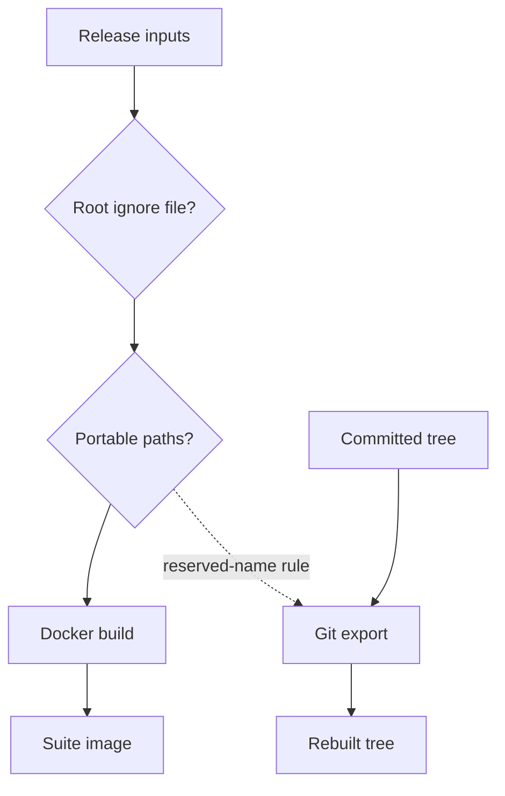

<h3>PR Summary by Qodo</h3>

Make suite builds portable across Docker builders and operating systems

<code>🐞 Bug fix</code> <code>✨ Enhancement</code> <code>🧪 Tests</code> <code>📝 Documentation</code> <code>🕐 40+ Minutes</code>

AI Description

<dl>
<dd>
 

><pre>
>• Reject root ignore files so classic Docker and BuildKit copy the same suite contents.
>• Reject Windows-reserved and case-conflicting paths before release builds or committed-byte
>  exports.
>• Cover both builders and document the release portability rules.
></pre>

</dd>
</dl>

Diagram

<dl>
<dd>

 

</dd>
</dl>

High-Level Assessment

<dl>
<dd>

 

>The following are alternative approaches to this PR:

<b>1. Stage a clean build context</b>

<dl>
<dd>

- ➕ Could retain root ignore files in the source suite.
- ➖ Adds a copying step and another tree whose contents must be verified.
- ➖ Does not remove the need to validate paths for cross-platform export.

</dd>
</dl>

>**Recommendation:** Keep the PR&#x27;s preflight rejection approach. It makes the source suite the build context for either Docker builder and preserves a direct comparison between the suite and image; staging would complicate that guarantee.

</dd>
</dl>

 Files changed (8) <code> +203 / -39 </code> 

<dl>
<dd>

 

Bug fix (1) <code> +59 / -3 </code>

<dl>
<dd>

release.py<code>Reject non-portable release inputs and export paths</code> <code>+59/-3</code>

 

>Reject non-portable release inputs and export paths
>
><pre>
>• Release-input validation now rejects root Docker or container ignore files, reserved path components, and case conflicts. Git export checks reserved names across committed paths before writing any bytes.
></pre>
>
><a href='https://github.com/SigorMatt/harness-bench/pull/9/files#diff-dffdbb27cb5ed15cd9c455959d38dd9cb968826603c23d04c7089df62dd56a05'>hb/release.py</a>

</dd>
</dl>

Tests (2) <code> +108 / -17 </code>

<dl>
<dd>

test_release.py<code>Test ignore-file and path-portability rejection</code> <code>+69/-0</code>

 

>Test ignore-file and path-portability rejection
>
><pre>
>• Tests cover root ignore files, allowed nested ignore files, reserved names, case conflicts, and export rejection before writes. Where Python 3.13 is available, parametrized cases compare the name rule with ntpath.isreserved.
></pre>
>
><a href='https://github.com/SigorMatt/harness-bench/pull/9/files#diff-5614bdd8567cb2d34c39f4c8592ae23121af38ce2ef744ddb0640352f825e926'>tests/test_release.py</a>

test_run_task_docker.py<code>Exercise suite images with both Docker builders</code> <code>+39/-17</code>

 

>Exercise suite images with both Docker builders
>
><pre>
>• The suite-image test now checks a nested ignore file and dotfile without relying on BuildKit, while a separate BuildKit-only test verifies override precedence. The registry-guard test accepts output from either stream, removes --progress, and forces container cleanup.
></pre>
>
><a href='https://github.com/SigorMatt/harness-bench/pull/9/files#diff-091eac90697dc045a5dbec15548988e1769eec2765296b8aa8f8becc0e597b72'>tests/test_run_task_docker.py</a>

</dd>
</dl>

Documentation (5) <code> +36 / -19 </code>

<dl>
<dd>

release.yml<code>Describe the expanded release-input checks</code> <code>+4/-2</code>

 

>Describe the expanded release-input checks
>
><pre>
>• The workflow comment now identifies root ignore files and non-portable suite paths as reasons the unprivileged inputs job can reject a release.
></pre>
>
><a href='https://github.com/SigorMatt/harness-bench/pull/9/files#diff-87db21a973eed4fef5f32b267aa60fcee5cbdf03c67fafdc2a9b553bb0b15f34'>.github/workflows/release.yml</a>

suite.Dockerfile<code>Clarify builder-independent suite copying</code> <code>+6/-3</code>

 

>Clarify builder-independent suite copying
>
><pre>
>• The Dockerfile comments explain that preflight rejection of root ignore files keeps the classic builder and BuildKit from omitting suite contents.
></pre>
>
><a href='https://github.com/SigorMatt/harness-bench/pull/9/files#diff-5a123feb33b9bfcc4093c1ed728098f210c3677e0814d14518d65696d4d3897e'>docker/suite.Dockerfile</a>

suite.Dockerfile.dockerignore<code>Limit the override-file guarantee to BuildKit</code> <code>+2/-2</code>

 

>Limit the override-file guarantee to BuildKit
>
><pre>
>• The comment now describes the empty ignore file as a BuildKit-only second guard rather than a guarantee for all builders.
></pre>
>
><a href='https://github.com/SigorMatt/harness-bench/pull/9/files#diff-1b472c13cc2fd4f19af5f6fb145c3af6eb810777695b5e3e66b1d77d7d248147'>docker/suite.Dockerfile.dockerignore</a>

result-bundle.md<code>Specify portable suite and export requirements</code> <code>+21/-10</code>

 

>Specify portable suite and export requirements
>
><pre>
>• The release specification now prohibits root ignore files, Windows-reserved names, and case-conflicting suite paths. It also explains why committed-byte export checks reserved names before writing.
></pre>
>
><a href='https://github.com/SigorMatt/harness-bench/pull/9/files#diff-2165efa4eeda3a5b7c8a6ab23d514b24097e696cb663a4d677b5670d0a25fd48'>docs/spec/result-bundle.md</a>

release.py<code>Document the inputs command’s portability checks</code> <code>+3/-2</code>

 

>Document the inputs command’s portability checks
>
><pre>
>• The command description now states that inputs checks suite-image completeness and whether the suite tree can be rebuilt across operating systems.
></pre>
>
><a href='https://github.com/SigorMatt/harness-bench/pull/9/files#diff-89ed454114d0872b1f47e4be4810fc351f5b8a09b82c9ee1b1b064f175bfa4b8'>scripts/release.py</a>

</dd>
</dl>

</dd>
</dl>

